# ⚡ RACK Designer Next — Consola del Datacenter
> **Sistema Web Integral de Modelado Físico, Arquitectura de Infraestructura y Topología de Redes**  
> *Desarrollado en Google Antigravity IDE · 100% Vanilla JavaScript (ES6+), HTML5 y CSS3 · Cero Compilación (No Build Step) · PWA Offline-First*

[](../../../index.html)
[](../../../js/main.js)
[](../../../css/style.css)
[](https://deepmind.google)
[](../../../service-worker.js)
[](../../../js/auth/crypto.js)
[](../../../js/ui/topology/TopologyRenderer.js)
[](../../../tests/index.html)

---

## 🖥️ ¿Qué es RACK Designer Next?

**RACK Designer Next** es una consola web de ingeniería y diseño de Centros de Datos (Data Centers) de nivel profesional que corre **100% en el navegador web sin necesidad de servidores, bases de datos externas ni pasos de compilación**.

Permite a arquitectos de infraestructura, ingenieros de redes y técnicos de operaciones:
1. **Modelar centros de datos completos en 2D y 3D**, organizados en múltiples salas y gabinetes estándar EIA-310 (de 4U a 48U).
2. **Poblar servidores y equipos de telecomunicaciones** mediante un catálogo visual modular con más de 20 tipos de hardware real.
3. **Planificar el cableado estructurado** con enrutamiento inteligente y bicanalidad segregada (datos por bandeja aérea y potencia por piso técnico).
4. **Visualizar la topología lógica de red en tiempo real** mediante un potente motor Canvas 2D con físicas automáticas, 3 modos de visualización y 5 memorias rápidas.
5. **Gestionar inventarios con importación y exportación masiva** a Excel/CSV, planos vectoriales de alta fidelidad e informes listos para producción.

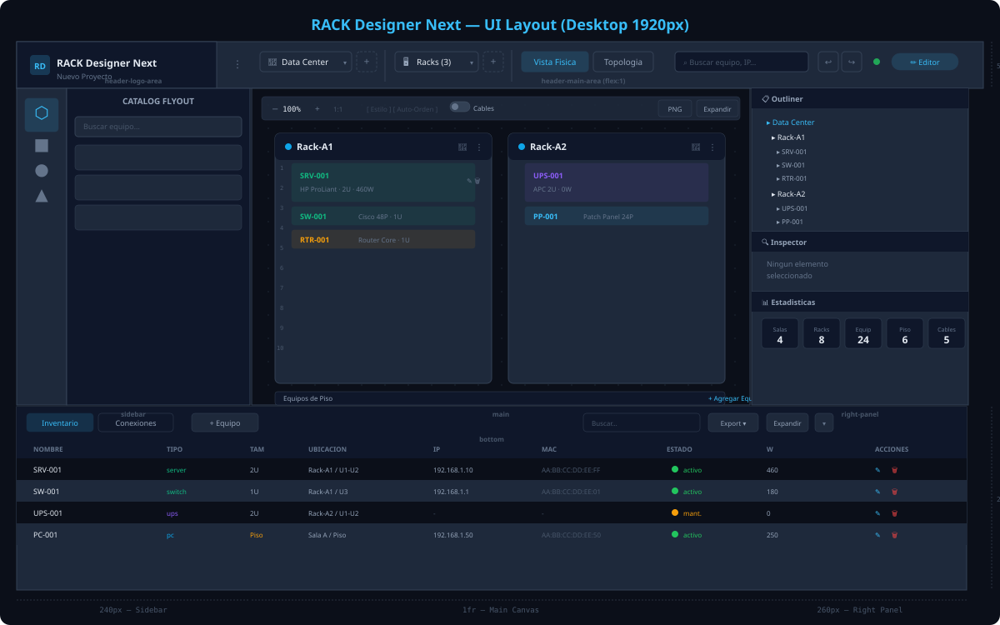

---

## 🚀 ¿Qué Puede Hacer el Proyecto? (Capacidades Clave)

### 1. 🗄️ Modelado Físico y Gestión de Racks (2D con Animación 3D)
- **Gabinetes Paramétricos:** Soporte para gabinetes desde 4U hasta 48U de altura, con cálculo milimétrico estandarizado de 24px por unidad U (44.45 mm).
- **Inspección Frontal y Dorsal (Flip 3D):** Con un solo clic o atajo, cada rack gira sobre su eje en 3D para inspeccionar el cableado y los puertos posteriores.
- **Catálogo de 21 Plantillas de Hardware:** Servidores 1U/2U/4U, Switches de acceso y core, Routers, Firewalls UTM, cabinas SAN/NAS, Patch Panels y PDUs.
- **Detección Automática de Colisiones:** El sistema impide desbordamientos de unidades U o solapamientos entre equipos al arrastrar.
- **Equipos de Piso (*Floor Devices*):** Modelado de SAIs/UPS de gran tonelaje, generadores y tableros eléctricos ubicados fuera de los gabinetes.

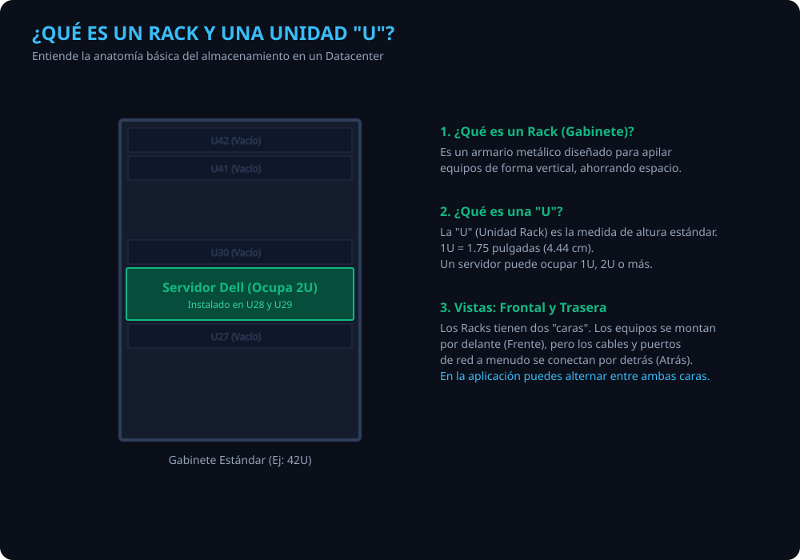


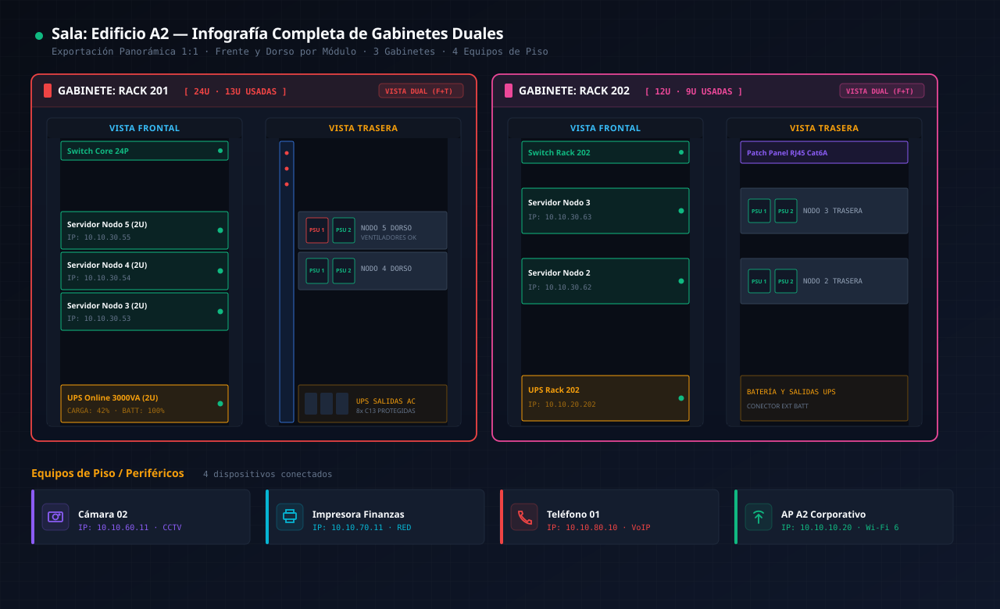

---

### 2. ⚡ Bicanalidad Segregada de Cableado (Techo y Piso Técnico)
- **Segregación Física de Red:** Trazado independiente para cables de **Datos** (a través de canastillos y bandejas aéreas superiores) y cables de **Alimentación Eléctrica / Potencia** (a través de canaletas bajo piso técnico).
- **Cálculo de Cotas Ortogonales:** Enrutamiento matemático que evita cruces caóticos de cables mediante canalizaciones alineadas con los rieles del gabinete.
- **Acciones Rápidas de Inversión (Swap `⇄`):** Conmutación instantánea de canaleta (⬆️ Techo ⇄ ⬇️ Piso) para cualquier enlace con un solo toque.
- **Soporte de Medios:** Cableado de Cobre (UTP/STP Cat6a), Fibra Óptica Monomodo (SM) y Multimodo (MM), y cables DAC de conexión directa.
- **Conexión Táctil Drag-to-Connect:** Conecta puertos arrastrando el cursor o dedo directamente de extremo a extremo.


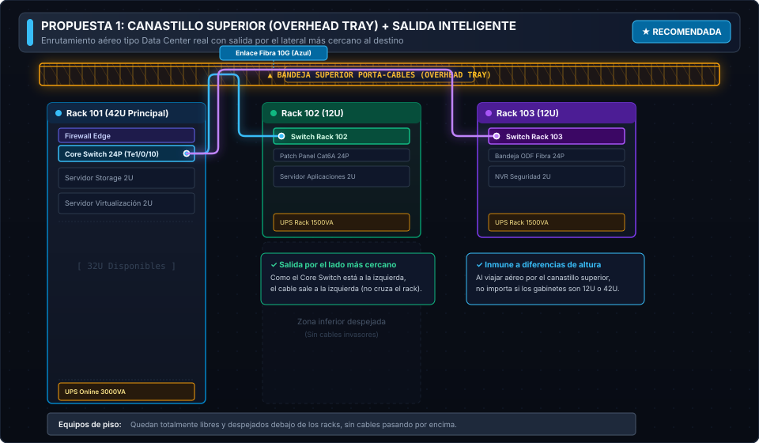

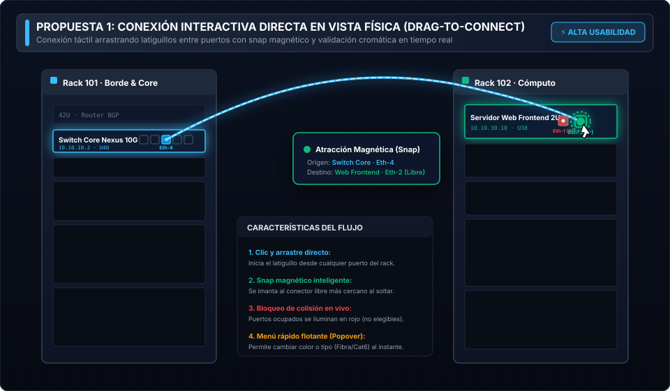

---

### 3. 🌐 Motor de Topología Lógica de Red (Canvas 2D a 60 FPS)
- **Físicas y Auto-Distribución:** Disposición automática por algoritmos de árbol jerárquico (DAG) y agrupación por gabinetes físicos.
- **3 Modos de Visualización de Nodos:**
  - **Modo Círculos:** Vista clásica de topología de red limpia.
  - **Modo Tarjetas:** Bloques con nombre de equipo, IP, MAC y conteo de puertos activos.
  - **Modo Hardware (Skins Fotorrealistas):** Renderizado de chasis metálicos oscuros con biseles, bahías de discos, LEDs y orejas de fijación (18 presets offline).
- **5 Ranuras de Memoria Rápida (TopologySlots):** Guarda y alterna al instante entre 5 disposiciones visuales o encuadres de la red sin recargar la página.
- **Smart Focus en Cableado:** Al pasar el cursor sobre cualquier enlace, los cables no relacionados se atenúan en un 80% para identificar el circuito de extremo a extremo sin distracciones.


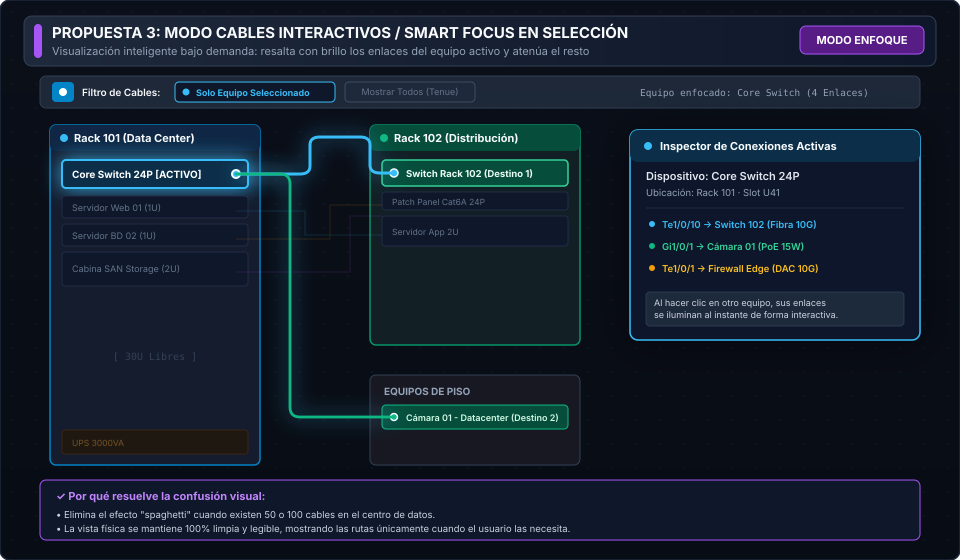

---

### 4. 🎨 Motor Tri-Tema Adaptativo (Oscuro, Claro y Sepia)
Diseñado para adaptarse a cualquier entorno operativo y condición de iluminación:
- 🌙 **Modo Oscuro Datacenter (`#0b0f19`):** Interfaz inmersiva de alto contraste inspirada en consolas de misión crítica y centros de monitoreo NOC.
- ☀️ **Modo Claro Operativo (`#f8fafc`):** Máxima nitidez y contraste diurno para trabajo en oficinas y generación de informes imprimibles.
- ☕ **Modo Sepia Cálido (`#2d241e`):** Paleta tonal suave con baja emisión de luz azul para reducir la fatiga ocular durante guardias y turnos nocturnos prolongados.

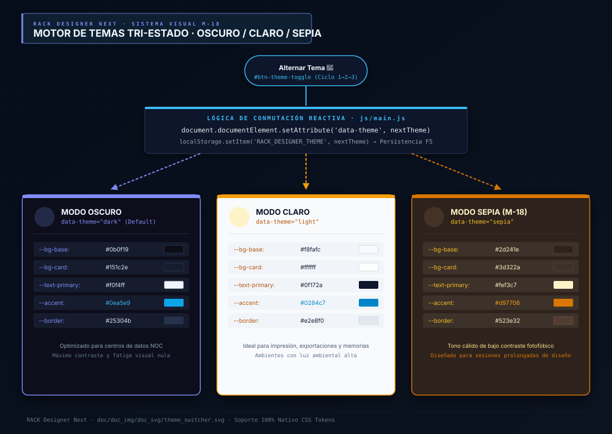


---

### 5. ⚡ Núcleo Reactivo Ultrarrápido (Zero Frameworks, Zero Build Step)
- **Reactividad Nativa con Proxy ES6:** Todo el estado del sistema reside en un almacén reactivo único (`store.js`). Cada cambio dispara mutaciones atómicas que persisten en `localStorage` y notifican a las vistas suscritas.
- **Despacho a 60 FPS con `requestAnimationFrame`:** Coalescencia de eventos que evita renders innecesarios y garantiza animaciones suaves sin caídas de frames.
- **Redibujado Granular $O(1)$ (`renderSingleRack`):** Si se añade un equipo al Rack 2, el sistema solo redibuja el Rack 2, dejando el resto del DOM intacto.
- **Máquina del Tiempo (Undo/Redo Instantáneo):** Historial simétrico de 15 niveles gestionado con el algoritmo `fastClone` (4 veces más rápido que JSON), ahorrando hasta un 80% de memoria RAM.


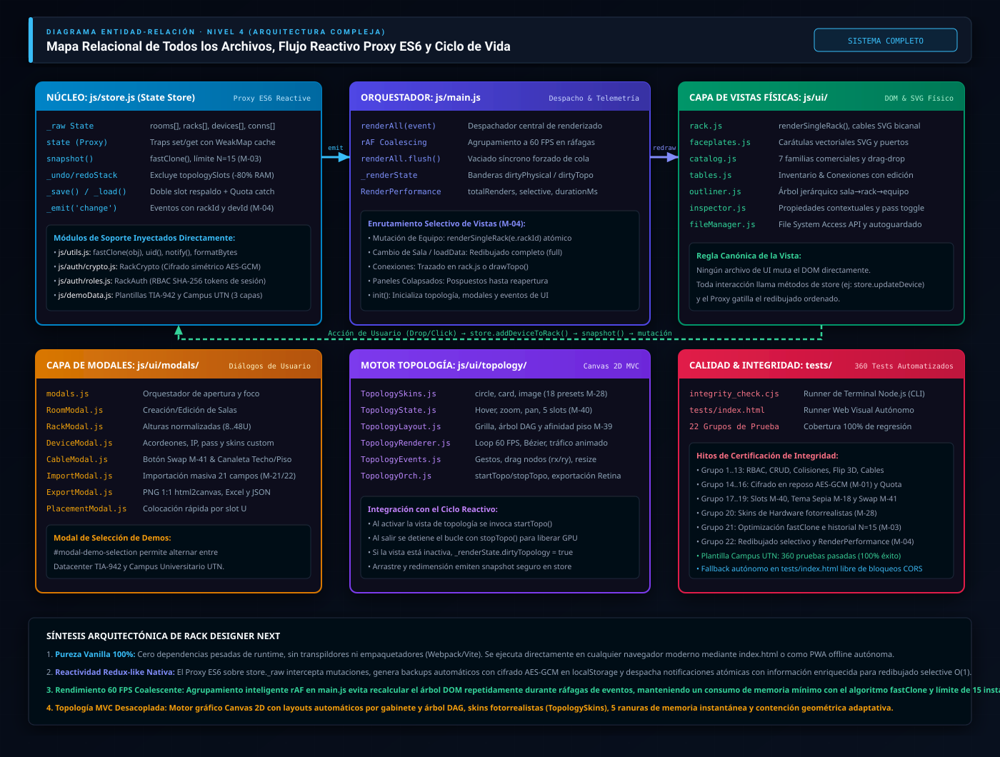

---

### 6. 🔒 Seguridad en Reposo y Control de Acceso (RBAC)
- **Matriz de 3 Roles de Usuario:**
  - 👑 **Admin (Modo Dios):** Control total, creación y borrado de salas, revelación de credenciales y administración de usuarios.
  - 🛠️ **Editor:** Edición completa de racks, equipos y conexiones, sin acceso a credenciales administrativas.
  - 👁️ **Viewer (Auditoría):** Acceso en solo lectura para inspección técnica y auditorías de inventario.
- **Autenticación Local Segura:** Credenciales protegidas con función resumen **SHA-256** persistidas únicamente en `sessionStorage` volátil.
- **Cifrado Simétrico AES-GCM (Web Crypto API):** Almacenamiento local y archivos `.rack` cifrados con claves derivadas por PBKDF2 (100.000 iteraciones) para protección contra manipulaciones.


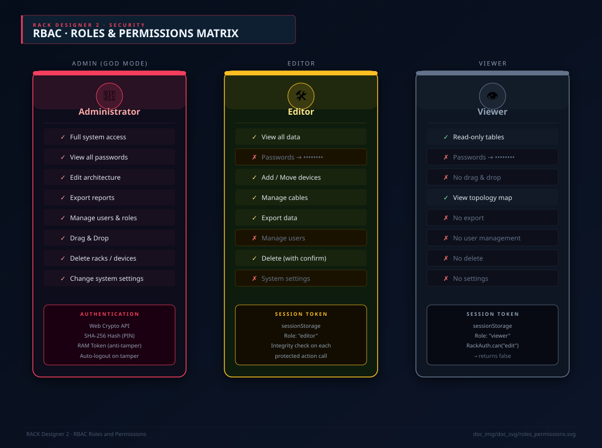

---

### 7. 📊 Importación y Exportación Masiva de Datos
- **Importación Inteligente desde Excel y CSV:** Ingesta de cientos de dispositivos en segundos con detección automática de columnas, resolución de colisiones de slots y capacidad de *Rollback* atómico con Deshacer.
- **Exportación Gráfica de Planos en Alta Resolución:** Generación de imágenes PNG a escala Retina 1:1 mediante `html2canvas`.
- **Informes de Conectividad e Inventario:** Hojas de cálculo Excel (`.xlsx`) y tablas CSV con puertos asignados, longitudes de cable, VLANs y consumo energético en Watts.
- **Archivo de Proyecto Abierto (`.rack`):** Guardado nativo compatible con la File System Access API del navegador (Guardar directo con Ctrl+S sin diálogos de descarga).

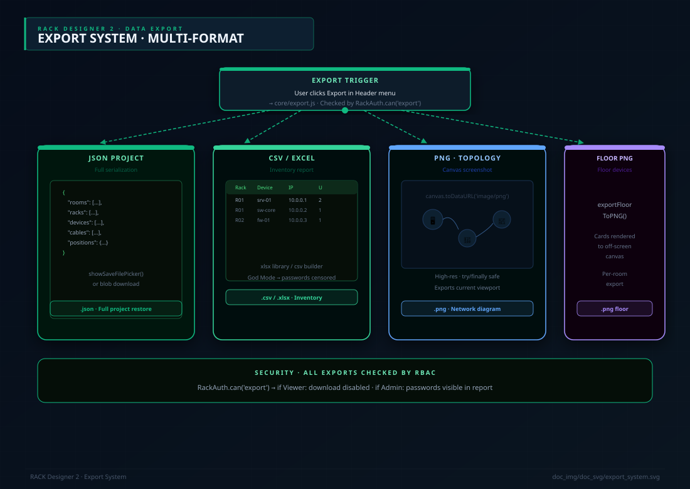

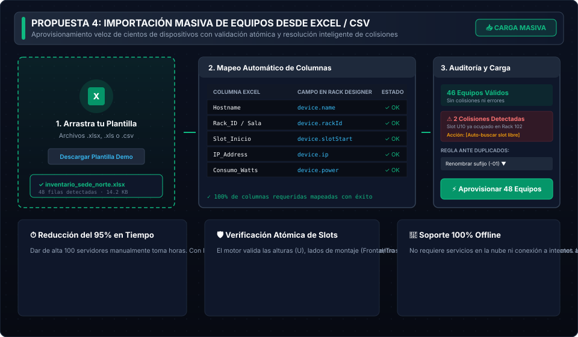


---

### 8. 🏢 Plantillas de Datacenter Listas para Usar y Flujo de Trabajo
El sistema incluye de fábrica demostraciones preconfiguradas para pruebas inmediatas:
- **Datacenter Corporativo TIA-942:** Arquitectura empresarial completa con gabinete de Core, racks de distribución, servidores blade y almacenamiento SAN.
- **Campus Universitario UTN:** Topología jerárquica de 3 capas (Núcleo, Distribución y Acceso) con **24 VLANs preconfiguradas** (VLAN 10 Gestión, VLAN 20 Alumnos, VLAN 30 Servidores, VLAN 40 DMZ, etc.).


---

## 🛠️ Stack Tecnológico y Arquitectura en 5 Capas

| Componente | Tecnología | Propósito y Ventajas |
|:---|:---|:---|
| **Motor Lógico** | **Vanilla JavaScript (ES6+)** | Cero dependencias pesadas. Corre nativo en cualquier navegador moderno sin transpilar. |
| **Estructura** | **HTML5 Semántico** | Accesibilidad, semántica clara y marcado optimizado para rendimiento. |
| **Estilos** | **CSS3 Puro (Variables + Grid)** | Arquitectura BEM modular, diseño fluido y temas dinámicos sin librerías como Tailwind. |
| **Gráficos** | **Canvas 2D + W3C SVG 1.1** | Motor gráfico híbrido: SVG para precisión geométrica y Canvas para 60 FPS en grandes topologías. |
| **Criptografía** | **Web Crypto API (SubtleCrypto)** | Cifrado simétrico AES-GCM 256 bits y PBKDF2 nativo en hardware del navegador. |
| **Offline / PWA** | **Service Worker API** | Funcionamiento 100% offline y almacén en caché `rack-designer-next-cache-v3`. |
| **Hojas de Cálculo** | **SheetJS (xlsx.full.min.js)** | Generación y parseo local de archivos Excel `.xlsx` y `.csv`. |
| **Entorno IDE** | **Google Antigravity IDE** | Diseñado, optimizado y mantenido con estándares de ingeniería de Google Antigravity. |
| **Aseguramiento** | **Suite de 360 Pruebas** | Verificación automatizada de consistencia de estado, criptografía y renderizado al 100% de éxito. |

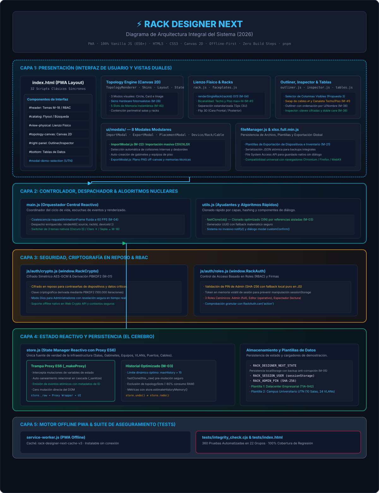

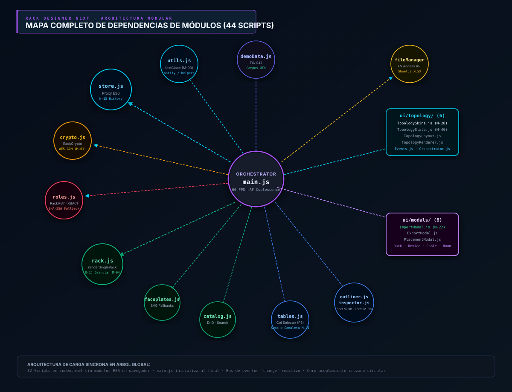

---

## ⏱️ Cómo Ejecutar el Proyecto en 1 Minuto

Al ser **100% Vanilla JavaScript y no requerir compilación ni instalación de paquetes**, poner en marcha la aplicación es inmediato:

### Opción 1: Con Live Server (Recomendada)
1. Abre la carpeta del proyecto en tu editor de código.
2. Haz clic derecho en `index.html` y selecciona **"Open with Live Server"**.

### Opción 2: Con Terminal (Cualquier servidor estático)
```bash
# Con npx (Node.js)
npx serve .

# O con Python
python -m http.server 8000
```
3. Abre tu navegador en `http://localhost:8000` (o el puerto indicado) ¡y listo!

---

## 📂 Organización de los 50 Planos Técnicos en Este Directorio

Los diagramas visuales que documentan cada subsistema se encuentran en las siguientes subcarpetas:

- 📐 **[`erd/`](erd/)** — 4 Modelos Entidad-Relación por niveles de complejidad (Atómico, Datacenter, Topología, Sistema Global).
- 🖥️ **[`layout/`](layout/)** — 9 Planos de cuadrantes del DOM, cabecera, barras laterales, selector tri-tema y canvas.
- 🏛️ **[`architecture/`](architecture/)** — 8 Mapas de arquitectura en 5 capas, dependencias de scripts y Service Worker.
- 🔄 **[`flows/`](flows/)** — 10 Flujos reactivos de datos, trampa Proxy, criptografía y ciclo de vida de la aplicación.
- 📖 **[`manual/`](manual/)** — 3 Infografías didácticas del manual: anatomía del rack 42U, mapa de interfaz y flujo básico.
- 💡 **[`propuestas/`](propuestas/)** — 16 Planos técnicos de cableado segregado, bicanalidad, smart focus y topología.

---

## 🔗 Enlaces a la Documentación Completa

- 📖 **Manual de Usuario Oficial:** [doc/doc_md/USER_MANUAL.md](../doc_md/USER_MANUAL.md)
- 🏛️ **Guía de Arquitectura Paso a Paso:** [doc/doc_md/ARCHITECTURE_GUIDE.md](../doc_md/ARCHITECTURE_GUIDE.md)
- 🗺️ **Mapa de Orientación del Código:** [doc/doc_md/CODEBASE_ORIENTATION_MAP.md](../doc_md/CODEBASE_ORIENTATION_MAP.md)
- 📏 **Especificaciones de Medidas Físicas:** [doc/doc_md/medidas/](../doc_md/medidas/)
- 📋 **Registro de Cambios del Proyecto:** [doc/log/CHANGELOG.md](../../log/CHANGELOG.md)
