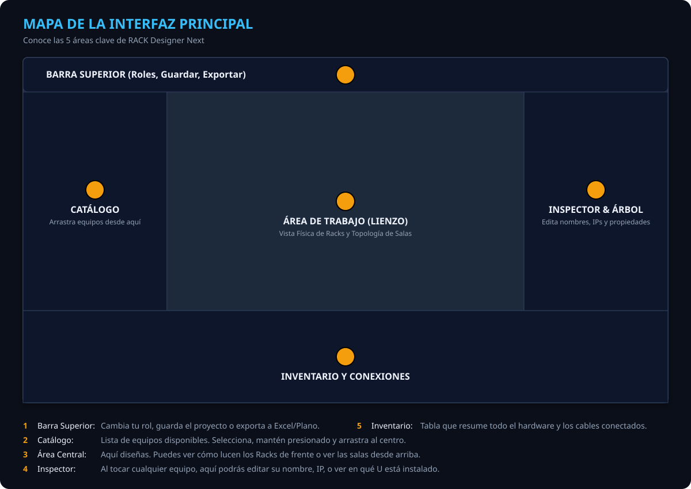
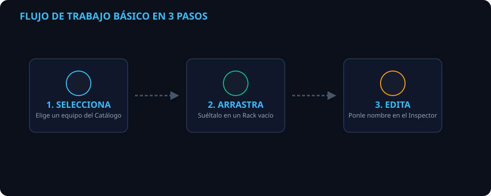

# RACK Designer Next — Manual de Usuario Definitivo

Bienvenido al manual paso a paso de **RACK Designer Next**, tu herramienta definitiva para gestionar salas, racks, equipos de telecomunicaciones y conexiones. Este manual está diseñado asumiendo que **no tienes experiencia previa** con la aplicación, por lo que te guiaremos desde lo más básico hasta que seas capaz de mapear un centro de datos completo.

---

## 📖 Parte 1: Conceptos Básicos (Para Principiantes)

Antes de hacer clic en cualquier botón, es vital entender qué estamos construyendo.

### ¿Qué es un Datacenter o Sala de Equipos?
Es simplemente una habitación física donde se guardan las computadoras centrales (servidores), los aparatos que reparten internet (switches, routers) y los sistemas de energía (baterías, aires acondicionados). En nuestra aplicación, todo empieza por crear una **Sala**.

### ¿Qué es un "Rack" o "Gabinete"?
Imagina un estante metálico, como un librero muy alto y estandarizado. Su propósito es apilar equipos uno encima del otro para ahorrar espacio. 
En nuestra aplicación, los Racks van **adentro de las Salas**.

### ¿Qué es una Unidad "U"?
Como los estantes del "Rack" están vacíos, necesitamos medir la altura de los equipos para saber cuántos caben. Para ello usamos la medida **"U"**.
- Un Rack de tamaño completo suele tener **42U** de espacio de arriba a abajo.
- Un equipo pequeño ocupa **1U**. Un servidor más grande puede ocupar **2U** o **4U**.

> [!TIP]
> **Vistas de un Rack (Frente y Atrás)**
> Los Racks tienen dos puertas. Por delante (Front) sueles ver los botones de encendido y discos duros. Por detrás (Rear) sueles ver los cables de poder y puertos de red. ¡La aplicación te permite girar el Rack para trabajar por ambas caras!

---

## 🗺️ Parte 2: Conociendo la Interfaz

Al abrir RACK Designer Next, verás tu área de trabajo dividida en **5 paneles principales**. 

1. **Barra Superior (Header):** Aquí administras tu "Rol" (para iniciar sesión como Admin y tener permisos para editar), el botón para Exportar tu plano a PNG (a escala Retina 1:1 sobre fondo de datacenter `#090d17`), CSV o Excel, y el botón para Guardar el archivo en tu computadora. También encontrarás los **tabs de vista** (Física / Topología), los controles de zoom, el interruptor para ocultar/mostrar cables, y los botones de Deshacer/Rehacer.
2. **Catálogo (Izquierda):** Es tu "tienda" de equipos con **30 plantillas arquitectónicas profesionales** organizadas en 8 familias comerciales: Redes (`network`), Cómputo (`computing`), Almacenamiento (`storage`), **Seguridad y CCTV (`security`)**, Energía (`power`), KVM (`kvm`), Accesorios y Cableado (`accesorios`) y Equipos de Piso (`floor`). Además incluye una pestaña superior **"Todos"** con buscador reactivo. Al hacer **clic en un icono**, se despliega el flyout donde puedes buscar, arrastrar equipos o crear **Equipos Personalizados por Proyecto** (`+ Equipo`) que se identifican con un distintivo `PROYECTO`.
3. **Área de Trabajo (Centro):** El lienzo principal. Aquí es donde los Racks cobran vida. En la parte superior de esta área (Cabecera), encontrarás los menús desplegables para seleccionar y crear Salas ("Data Center") y Racks, junto con las pestañas unificadas para cambiar entre **Vista Física** y **Topología**.
   - En la **Vista Física**, cada equipo se representa con carátulas vectoriales SVG de alta definición (servidores en rack 1U/2U/4U, switches de 24/48 puertos con actividad LED animada, routers, almacenamiento NAS/SAN con discos parpadeantes, grabadores NVR/DVR, UPS y PDUs), garantizando una escala visual 1:1 nítida en cualquier nivel de zoom. Los gabinetes cuentan con una separación técnica espaciosa de **`72px`** (3U).
   - **Enrutamiento Segregado de Cables:** Los cables se enrutan automáticamente en 3 zonas libres: **Canastillo Aéreo Superior** (entre gabinetes distintos, por encima del techo), **Canaleta Media** (para equipos de piso y periféricos hacia los racks) y **Organizador Lateral de Gabinete** (para enlaces internos del mismo rack), garantizando cero cruces sobre equipos o servidores.
4. **Inspector y Árbol (Derecha):** Cuando seleccionas un Rack o un servidor, en este panel verás sus propiedades completas. Se divide en tres secciones:
   - **Outliner:** Un árbol jerárquico (Salas → Racks → Equipos) con barra de herramientas (`+ Sala`, `+ Rack`, `+ Equipo`), selector de 4 modos de ordenación (por posición U, alfabético A-Z / Z-A y por tipo) y botones de acción rápida inline (`✏️` para editar y `🗑️` para eliminar con confirmación). Al hacer **clic en cualquier elemento del árbol**, la vista física saltará de sala automáticamente y hará un scroll suave para resaltarlo en pantalla.
   - **Inspector:** Panel de propiedades del elemento seleccionado, ahora **colapsable** para dar más espacio al árbol. Incluye **gestión activa (CRUD)** con botones rápidos para crear salas y gabinetes en estado vacío, y botones contextuales para editar o eliminar salas, racks y equipos de forma directa.
   - **Estadísticas:** Contadores globales (salas, racks, equipos en rack, equipos de piso, conexiones y balance de energía en Watts).
5. **Inventario (Abajo):** Una gran tabla tipo Excel con 18 columnas de metadatos (incluyendo Tamaño, Skin y Notas). 
   - **Gestión de Columnas:** Usa el botón `⚙ Columnas` para abrir un menú desplegable y seleccionar exactamente qué columnas deseas ver (Ubicación, Red, Energía, etc.). Tus preferencias se guardan automáticamente.
   - **Edición Rápida:** Permite **edición rápida en celda mediante doble clic** (`dblclick`) para modificar tamaño en U, apariencia o anotaciones sin abrir modales.

---

## 🔐 Parte 2.5: Roles y Permisos

Al abrir la aplicación por primera vez, verás un modal de inicio de sesión con tres opciones:

| Rol | Acceso | PIN Requerido |
|---|---|---|
| **Administrador** | Acceso total: editar, borrar, cambiar PIN, ver contraseñas | Sí (`rack2024` por defecto) |
| **Editor** | Editar equipos, racks, conexiones, guardar | No |
| **Espectador** | Solo ver datos, sin poder editar | No |

> [!IMPORTANT]
> **El PIN de Admin por defecto es `rack2024`.** Puedes cambiarlo desde el menú del proyecto → "Cambiar PIN Admin". El PIN se almacena como hash SHA-256 en tu navegador.
> 
> **Persistencia de Sesión:** Si recargas la página (F5), tu sesión como Administrador o Editor se mantendrá activa automáticamente sin pedirte el PIN nuevamente. Sin embargo, por seguridad, al cerrar la pestaña o el navegador, la sesión se destruye (`SESSION_EXPIRATION = VOLATILE`), requiriendo identificarse de nuevo en la siguiente visita.

---

## ⚡ Parte 3: Flujo de Trabajo y Operaciones Comunes

La aplicación fue diseñada para ser tan fácil como un juego de "arrastrar y soltar".

### Cómo moverse y seleccionar
- **Clic Izquierdo:** Selecciona un objeto (Rack, servidor, etc.). Al seleccionarlo, se iluminará y sus datos aparecerán en el panel de la derecha (Inspector).
- **Clic en el Outliner:** Selecciona elementos desde el árbol jerárquico y muestra sus propiedades.
- **Doble Clic en el Outliner:** Abre el modal de edición del elemento.
- **Rueda del Ratón:** Haz scroll para hacer acercar (Zoom In) o alejar (Zoom Out).
- **Arrastrar (Drag & Drop):** Haz clic sostenido en un equipo del catálogo izquierdo, muévelo hasta un hueco vacío en tu Rack, y suelta el botón.
- **Colocación Rápida Asistida:** En el menú inferior o contextual, usa "Colocación Rápida". Incluye un buscador reactivo para filtrar equipos y autocalcula los slots libres disponibles.
- **Arrastrar el fondo (Vista Física o Topología):** Mueve la vista completa (Pan).
- **Alternar Cables:** Activa o desactiva la visualización de cables en la vista física con el interruptor en la barra superior.

### Guardar y Cargar
La aplicación guarda **automáticamente** los cambios en la memoria temporal de tu navegador cada vez que haces un movimiento. Además, si tienes un archivo `.rack` abierto, se **autoguarda en disco** cada 3 segundos después del último cambio.

**Guardar manualmente:**
1. Ve a la **Barra Superior** → Menú del proyecto (⋮).
2. Haz clic en **"Guardar"** (guarda en el archivo actual) o **"Guardar como..."** (elige un nuevo archivo).
3. Se guardará un archivo con extensión `.rack`. ¡Ese es tu proyecto!

**Abrir un proyecto existente:**
1. Ve a la **Barra Superior** → Menú del proyecto (⋮).
2. Haz clic en **"Abrir"** y selecciona tu archivo `.rack` o `.json`.

### Deshacer y Rehacer
- **Ctrl+Z** o botón ↩ en el header: Deshace la última acción (hasta 30 pasos)
- **Ctrl+Y** o botón ↪ en el header: Rehace la acción deshecha

---

## 🎓 Parte 4: Tutoriales Prácticos Paso a Paso

¡Hora de la práctica! Vamos a crear tres salas distintas desde cero.

### Escenario 1: Datacenter Híbrido (Racks y Piso)
Vamos a crear una sala normal, que contiene 2 Racks con servidores, y adicionalmente un equipo pesado (Aire Acondicionado) que va en el piso, fuera de los racks.

**Paso 1: Crear la Sala y los Racks**
1. En la **Barra Superior (Cabecera)**, verás un menú desplegable que dice "Data Center" y a su lado un botón **"+"** (o en el Inspector con `+ Nueva Sala`).
2. Haz clic en el menú o selecciona la sala existente. En el panel Derecho (Inspector), cámbiale el nombre a `Mi Datacenter Híbrido`.
3. En la misma barra superior, junto al menú desplegable de "Racks", haz clic en el botón **"+"** para agregar un Rack (o usa `+ Nuevo Gabinete` en el Inspector). Aparecerá un cajón negro en el lienzo central con altura estándar (42U por defecto).
4. En el panel Derecho, ponle nombre a ese rack: `RACK-01`.
5. Repite el paso 3 y 4 para crear otro rack llamado `RACK-02`. Ambos gabinetes se ordenarán con una separación espaciosa de 72px.

**Paso 2: Llenar el RACK-01**
1. Ve al panel Izquierdo (Catálogo) y haz clic en el icono de **Cómputo / Servidores** para desplegar el flyout.
2. Haz clic sostenido sobre un "Servidor Rack 2U" y arrástralo hacia el `RACK-01` en el lienzo central. Suéltalo en un hueco vacío.
3. Haz clic en el icono de **Redes** en la barra de categorías. Arrastra un "Switch Acceso 24P (1U)" y suéltalo justo arriba del servidor.

**Paso 3: Añadir el equipo de piso**
1. En el Catálogo, busca la categoría **Floor / Piso** (iconos de PC, cámara, etc.).
2. Arrastra una "Unidad InRow (Aire Acondicionado)". Notarás que el sistema *no te deja* meterlo dentro del Rack. 
3. **¿Cómo lo coloco en el piso?** Muy simple: En la parte inferior del Rack, verás una zona punteada llamada **"Floor Equip (Exterior)"** alineada con un ancho mínimo de 584px. Suelta el equipo ahí.
4. Haz clic en el aire acondicionado recién colocado y, en el panel Derecho, llámalo `Aire-Principal`. ¡Felicidades, completaste el escenario 1!

---

### Escenario 2: Sala de Telecomunicaciones (Solo Racks)
Este cuarto más pequeño no tiene equipos en el piso, solo equipos de red y parcheo.

**Paso 1: Crear una Sala nueva**
1. Ve a la **Barra Superior (Cabecera)** y haz clic en el botón **"+"** que está al lado del selector de Salas ("Data Center").
2. En el panel Derecho, llámala `Cuarto de Telecomunicaciones`. Notarás que el lienzo central se vacía (porque entraste a tu nueva sala vacía).

**Paso 2: Montar el Gabinete de Red**
1. En la Barra Superior, haz clic en el botón **"+"** junto al selector de Racks y llámalo `RACK-TELCO` en el panel derecho.
2. Ve al Catálogo → Categoría **Network** (icono de switch).
3. Arrastra un "Patch Panel (1U)" a la parte más alta del rack.
4. Arrastra un "Router Core (4U)" debajo del patch panel.
5. Ve al panel Derecho y en las propiedades del Router escribe en la IP: `192.168.1.1`.

> [!NOTE]
> En este escenario no usamos equipos de piso. Tu vista principal (Topológica o Frontal) mostrará el cuarto ordenado y exclusivamente dedicado a equipos montados.

---

### Escenario 3: Sala de Fuerza / Energía (Solo Equipos de Piso)
En el sótano del edificio, tenemos una sala de baterías gigantes y generadores que no caben en ningún rack.

**Paso 1: Crear la Sala de Energía**
1. En la Barra Superior, haz clic en el botón **"+"** junto al selector de Salas.
2. En el panel Derecho, nómbrala `Cuarto de Baterías`.

**Paso 2: Llenar el cuarto sin usar Racks**
Dado que esta sala no necesita racks metálicos altos, insertaremos los equipos de manera independiente.
1. **NO** hagas clic en el botón "+" de Racks.
2. Ve directamente al Catálogo → Categoría **Floor / Piso**.
3. Arrastra un "Standalone UPS" hacia el lienzo vacío central.
4. Como no hay un Rack, la aplicación creará automáticamente una zona invisible (un chasis contenedor de piso) para alojarlo.
5. Arrastra un "Desk / Escritorio" al lienzo.
6. En el panel Derecho, renombra los equipos a `Batería-Principal` y `Mesa Operador`.

---

## 🔌 Parte 5: Visualización de Conexiones Físicas

¡Ahora también puedes visualizar cómo están conectados los cables en la vida real!

### Crear una conexión
1. Haz **doble clic** en un equipo (en la vista Topología o desde la tabla inferior).
2. Se abrirá el modal de **"Nueva Conexión"**.
3. Selecciona el equipo de origen, el equipo de destino y los puertos. 
   - *Tip:* Marca la casilla **"Mostrar solo puertos libres"** para ocultar los puertos que ya están ocupados y evitar errores.
   - **Botón Swap de Inversión (⇄, M-41):** Usa el botón central de intercambio `#btn-cable-swap` para alternar instantáneamente el origen y el destino con un solo clic.
   - **Orientación de Canaleta (M-41):** Elige entre **Canaleta Superior (Techo / Bandeja Aérea)** o **Canaleta Inferior (Piso Técnico / Fondo)** para segregar las rutas físicas del cableado.
4. Asigna una **VLAN** (ej. VLAN 10 Gestión, VLAN 20 Datos). El sistema sugerirá automáticamente un color de cable basado en la VLAN seleccionada.
5. Haz clic en **"Conectar"**. El sistema verificará que no haya colisiones antes de enlazar los puertos.

### Ver cables en la vista física
1. Ve a la **Vista Física** (botón superior central).
2. Haz clic en el interruptor deslizable **"Cables"** de la barra de herramientas.
3. Verás que se dibujan automáticamente los cables desde los puertos, organizados ortogonalmente:
   - Los cables con orientación **Superior** suben por las bandejas aéreas por encima de los gabinetes.
   - Los cables con orientación **Inferior** descienden por debajo de los racks a través de las canaletas del piso técnico.
4. Usa el botón rotar del rack para ver la parte trasera (Rear View) desde donde nacen las conexiones.

### Ver cables en la vista topológica
1. Cambia a la **Vista Topología** (botón superior central).
2. Las conexiones se muestran como curvas animadas con partículas de flujo.
3. **Pasa el mouse** sobre un nodo para resaltar solo sus conexiones directas.

---

## 🌐 Parte 6: Vista de Topología

La vista de topología es un diagrama de red interactivo donde puedes ver cómo están conectados todos tus equipos.

### Controles
- **Arrastrar nodo:** Mueve un equipo individual dentro de su rack o sala.
- **Arrastrar barra de rack (verde):** Mueve el rack completo con todos sus equipos.
- **Arrastrar barra de sala (naranja):** Mueve la sala completa.
- **Esquina inferior-derecha de sala/rack:** Cambia el tamaño (resize).
- **Rueda del mouse:** Zoom in/out.
- **Arrastrar el fondo:** Pan (mueve toda la vista).
- **Doble clic en un nodo:** Abre modal para crear una conexión.
- **Doble clic en un cable:** Abre modal para editar esa conexión.

### Cambiar estilo y representación visual de nodos (Skins Visuales M-28)
- Abre el menú desplegable **"🎛️ Estilo"** en la barra superior de topología para elegir entre tres modos de renderizado:
  - **Cards (Tarjetas):** Rectángulos técnicos de 150×50 px con icono, nombre e IP enfocado en lectura rápida de metadatos.
  - **Nodos (Círculos):** Círculos minimalistas de radio 22 px con icono centrado y etiquetas de nombre e IP configurables (Arriba, Abajo, Izquierda, Derecha o Juntos).
  - **Hardware (Skins Fotorrealistas):** Chasis arquitectónico de 140×50 px con bisel metálico, orejas laterales de montaje en rack, perforaciones de tornillos, carátula vectorial fotorrealista basada en 18 presets offline de fabricantes (Cisco, Dell, Fortinet, etc.) o fotos personalizadas en base64, badge de altura U y LED de estado operativo.
- Tu selección de estilo se guarda en el proyecto y puede conmutarse independientemente en cualquiera de los 5 slots de memoria (M-40).

### Carga de Fotos e Imágenes Personalizadas de Equipos (M-28)
- Puedes personalizar la apariencia visual de cualquier equipo en el diagrama de topología:
  1. Haz doble clic en el equipo o selecciónalo y pulsa "Editar" en el Inspector.
  2. En el formulario técnico del equipo, abre el bloque **"Personalización Visual"**.
  3. Puedes seleccionar un **Preset de Fabricante** predefinido (Servidor 1U/2U/4U, Switch ToR/Core, Router, Firewall UTM, Cabina Storage, Cámara CCTV, Punto de Acceso Wi-Fi, etc.).
  4. O bien, pulsa el botón **"Subir Imagen..."** para cargar una imagen propia (`.png`, `.jpg`, `.svg`). La imagen se optimiza y se almacena directamente en tu archivo de proyecto `.rack` codificada en base64 sin requerir servidores ni conexión a internet.
  5. Para remover una imagen personalizada y volver al gráfico vectorial de fábrica, basta con hacer clic en la miniatura interactiva de previsualización.

### Modo de Layout (Por Racks vs Árbol Jerárquico)
- Puedes alternar entre **Organización por Racks** (agrupa los nodos dentro de sus respectivos gabinetes) y **Árbol Jerárquico** (organización tipo Draw.io de arriba hacia abajo: Core → Distribución → Acceso, con cables ortogonales redondeados).

### Ajustar el espaciado (Control Dual H y V)
- Abre el menú desplegable **"🎛️ Estilo"** en la barra superior de topología:
  - **Barra H (Horizontal):** Ajusta la distancia entre columnas de equipos y nodos hermanos (lectura interactiva en px).
  - **Barra V (Vertical):** Ajusta la separación vertical entre niveles de red y slots (lectura interactiva en px).

### 💾 Guardar y Alternar entre 5 Vistas de Topología (M-40)
- En la barra superior dispones de la botonera compacta: `👁️ [ 1 ] [ 2 ] [ 3 ] [ 4 ] [ 5 ] [ 💾 ]`.
- **Guardar una vista:** Haz clic en cualquier botón de ranura vacía (con borde discontinuo) para guardar al instante las posiciones de los nodos, encuadre (zoom y pan), estilo y espaciados actuales.
- **Alternar o cargar una vista:** Haz clic en cualquier número de ranura guardada para conmutar inmediatamente a ese estado sin recargar la página. La ranura activa se resalta con un brillo azul cian.
- **Gestión avanzada:** Haz clic en el icono del disquete `[ 💾 ]` para abrir el menú de gestión:
  - Puedes **Renombrar** cada vista con nombres descriptivos (ej. *"1: Red Core"*, *"2: Cámaras CCTV"*).
  - Puedes **Sobrescribir** o **Vaciar** cualquier ranura con un clic.
  - El sistema de deshacer/rehacer (`Ctrl+Z` / `Ctrl+Y`) funciona de forma totalmente independiente sin alterar tus ranuras guardadas.

### 📍 Afinidad Automática de Equipos de Piso por Gabinete (M-39)
- Los equipos de piso (cámaras de seguridad CCTV, puntos de acceso Wi-Fi, estaciones de trabajo, impresoras de red) se ordenan de forma inteligente **directamente debajo del rack al que están conectados**.
- Esto hace que los cables de red desciendan rectos y directos desde el switch ToR/distribución hasta sus periféricos, eliminando los molestos cruces de cables diagonales que antes atravesaban toda la sala.
- Todos los racks conservan una **misma línea de base horizontal**, asegurando una cuadrícula simétrica, ordenada y elegante.

### 🔍 HUD Tooltip Ergonómico y Nombres Técnicos
- Al pasar el cursor sobre cualquier nodo en topología, se despliega una tarjeta HUD de **240px** con soporte multilínea para nombres extensos y credenciales protegidas.
- Nombres de más de 17 caracteres en tarjetas y círculos se abrevian con una elipsis elegante (`…`), preservando las dimensiones estándar y la geometría intacta de los racks.

### Reordenar automáticamente
- Haz clic en **"Auto"** (o botón `⚡ Auto`) para que la aplicación recalcule y alinee automáticamente todas las posiciones del diagrama respetando las dependencias de red y la afinidad de gabinetes.

### Exportar como imagen
- Desde el menú de exportación o el botón **"PNG"** de la barra, descarga una imagen de alta resolución del diagrama.

---

## 📊 Parte 7: Exportación e Importación de Datos

Desde el menú del proyecto o la barra inferior, puedes exportar e importar datos con herramientas profesionales:

| Formato | Contenido | Cómo |
|---|---|---|
| **PNG (Racks)** | Imagen de la vista física de cada rack a escala Retina 1:1 (`html2canvas`) | Exportar → Rack a PNG |
| **PNG (Topología)** | Imagen del diagrama de red completo en Canvas 2D | Exportar → Topología PNG |
| **CSV** | Tabla de inventario de equipos | Botón CSV en la tabla inferior |
| **Excel (.xlsx)** | Inventario + conexiones en hojas separadas | Botón Excel en la tabla inferior |
| **Plantilla Equipos (Excel / CSV, M-21)** | Plantilla estructurada con 21 campos y hoja `"Guia_Valores"` | Exportar → Plantilla Equipos |
| **Importación Masiva (CSV / Excel, M-22)** | Carga masiva de equipos con detección de colisiones y auto-racks | Tablas → Botón "Importar..." o Menú Proyecto |
| **JSON (.rack)** | Proyecto completo (datos + catálogo + cifrado en reposo) | Guardar / Guardar como |

### 📥 Cómo usar la Importación Masiva (M-22):
1. Descarga la plantilla desde el menú **Exportar** → **Plantilla Equipos (Excel .xlsx)**.
2. Completa los datos de tus equipos siguiendo la hoja de ayuda integrada `"Guia_Valores"`.
3. En la pestaña Tablas, haz clic en el botón **"Importar..."** (o desde el Menú del Proyecto → **"Importar Equipos (CSV/Excel)"**).
4. Arrastra tu archivo `.xlsx` o `.csv` a la zona de carga.
5. El sistema analizará instantáneamente las filas:
   - Valida formatos de IP, MAC y altura en U.
   - Detecta colisiones físicas de slots en los racks.
   - Te permite elegir cómo resolver nombres duplicados (Omitir, Renombrar o Sobrescribir).
   - Crea automáticamente los racks que no existan si marcas la opción correspondiente.
6. Haz clic en **"Confirmar e Importar"**. Si cometes un error, puedes presionar **Ctrl+Z** para deshacer toda la importación de un solo golpe.

---

## 🎨 Parte 8: Temas y Personalización

### Selector de Temas Visible (M-18)
En la barra superior (cabecera), junto a los botones de Deshacer y Rehacer, dispones del botón directo de tema con icono dinámico y etiqueta:
- **Modo Oscuro (🌙):** Tema por defecto de alto contraste para entornos oscuros y reducción de consumo energético.
- **Modo Claro (☀️):** Fondo claro de alta luminosidad para oficinas bien iluminadas o presentaciones.
- **Modo Sepia (☕):** Paleta cálida relajante (tonos pergamino, texto café y acentos ámbar) diseñada específicamente para cuartos de control y largas jornadas de monitoreo sin fatiga ocular.

> [!TIP]
> **Cambio rápido con un solo clic:** Haz clic sobre el botón en la cabecera para ciclar instantáneamente: **Oscuro** ➔ **Claro** ➔ **Sepia** ➔ **Oscuro**. Tu preferencia se guarda automáticamente en el navegador y se recuerda en tus próximas sesiones. También puedes alternar el tema desde el menú principal del proyecto (⋮).

### Modo Dios y Cifrado en Reposo (M-01)
- **Seguridad en Reposo:** Las contraseñas se almacenan cifradas con AES-GCM (`enc:v1:`) en tu navegador (`localStorage`) y en respaldos `.rack`. En reposo nunca reside texto plano.
- En la interfaz, las contraseñas se enmascaran por defecto como `••••••••`.
- **Revelación Táctil:** Los Administradores pueden hacer clic en el botón de ojo (`👁`) en el Inspector para revelar la contraseña de un equipo específico.
- **Modo Dios Global:** Desde el menú del proyecto (⋮) → **"Modo Dios: Revelar Claves"**, el Administrador puede revelar simultáneamente todas las contraseñas en tablas e inspectores.
- Solo los usuarios con rol Administrador tienen autorización para activar estas opciones.

### Pausar animaciones
- Haz clic en el **punto verde** (status dot) de la barra superior para pausar/reanudar las animaciones de las partículas en la topología.

---

¡Has completado tu capacitación básica! Ahora sabes cómo navegar por la aplicación, qué significan los conceptos, cómo arrastrar componentes y cómo estructurar cuartos enteros según tus necesidades del mundo real. 

Si te equivocas, recuerda usar la opción de **Deshacer (Undo)** con Ctrl+Z o simplemente seleccionar el equipo mal colocado y presionar el botón **Eliminar (Trash/Basurero)** en el Inspector (Panel Derecho).
