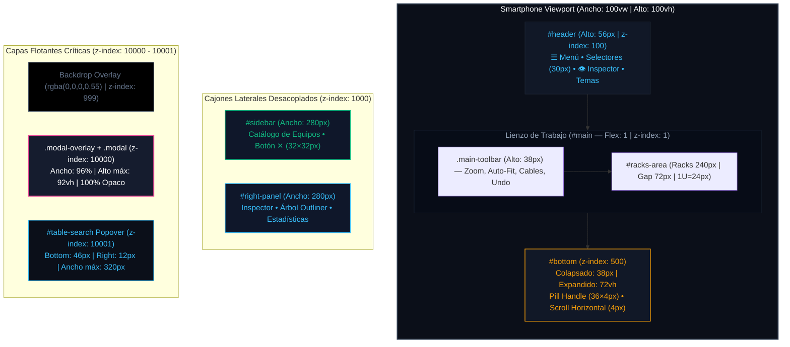

# Dimensiones y Medidas del Modo Móvil (Mobile Layout & Responsive Breakpoints)

Este documento detalla el esquema de layout, dimensiones de componentes, cajas CSS, comportamiento cinético y esquemas visuales de proporciones que componen la interfaz de usuario de **RACK Designer Next** en smartphones y tablets (`≤ 768px` y `≤ 480px`).

---

## 1. Estructura y Dimensiones Estructurales Base

En dispositivos móviles, la interfaz abandona la cuadrícula rígida de 3 columnas de escritorio y transmuta a un modelo desacoplado basado en cajones laterales (*Off-Canvas Drawers*) y hoja inferior (*Bottom Sheet*), maximizando el área visual útil para la gestión del datacenter:

```css
@media (max-width: 768px) {
  #app {
    display: flex;
    flex-direction: column;
    height: 100vh;
    overflow: hidden;
    position: relative;
  }

  /* Paneles laterales desacoplados del flujo */
  #sidebar, #right-panel {
    position: fixed;
    top: 56px;
    bottom: 0;
    width: 280px;
    max-width: 85vw;
    z-index: 1000;
    transition: transform 0.3s cubic-bezier(0.4, 0, 0.2, 1);
    will-change: transform;
  }

  #sidebar { left: 0; transform: translateX(-100%); }
  #sidebar.open { transform: translateX(0); }

  #right-panel { right: 0; transform: translateX(100%); }
  #right-panel.open { transform: translateX(0); }
}
```

### 🧱 Estados Dinámicos de la Interfaz Móvil

*   **Estado 1: Lienzo Libre (Default):** Paneles laterales ocultos (`translateX(±100%)`). El lienzo central `#main` ocupa el **`100%` (`100vw`)** del ancho visible y el panel inferior permanece colapsado a **`38px`**, dejando más del **`80%`** de la pantalla totalmente despejada para ver y manipular los racks.
*   **Estado 2: Catálogo Off-Canvas (Drawer ☰):** Se desliza desde el borde izquierdo cubriendo **`280px`** sobre un backdrop oscuro semitransparente (`rgba(0,0,0,0.55)` en `z-index: 999`).
*   **Estado 3: Inspector / Árbol Off-Canvas (Drawer 👁):** Se desliza desde el borde derecho cubriendo **`280px`** al pulsar el botón `👁` de la cabecera o al hacer **un toque directo (*tap*) sobre cualquier equipo en el lienzo**.
*   **Estado 4: Hoja Inferior Expandida (*Bottom Sheet* ▲):** El panel de inventario y conexiones se despliega verticalmente cubriendo el **`72vh`** (hasta `85vh` en swipe máximo) de la pantalla.
*   **Estado 5: Ventana Modal Activa:** Cuadros de diálogo al **`96%`** del ancho de la pantalla, fondo 100% opaco y scroll vertical táctil fluido.

---

## 2. Cabecera Móvil (`#header`)

La cabecera permanece fija en el tope de la pantalla (`position: sticky; top: 0; z-index: 100;`) manteniendo un acceso ergonómico para el pulgar:

*   **Altura Total:** **`56px`** (`--header-h`).
*   **Padding Lateral:** `0 12px` (en pantallas ultra-angostas `≤ 480px`: `0 8px`).
*   **Botón Menú Hamburguesa (`#btn-mobile-menu`):** Ancho y alto normalizados de **`34px` × `34px`** con icono `☰` centrado (16px).
*   **Selectores Desplegables (Sala y Rack):**
    *   Altura de botón: **`30px`** (`flex-shrink: 1`).
    *   Ancho en `≤ 768px`: `calc(50% - 24px)`.
    *   Ancho en `≤ 480px`: `flex: 1 1 0; min-width: 0;` con elipsis tipográfica (`text-overflow: ellipsis`) para evitar empujar botones.
*   **Botón Inspector Sticky (`#btn-mobile-inspector`):** Tamaño de **`34px` × `34px`** con icono de ojo `👁` (14px) para alternar el inspector derecho.
*   **Selector de Temas (`#btn-theme-toggle`):** Tamaño de **`30px` × `30px`** (Oscuro 🌙 ⇄ Claro ☀️ ⇄ Sepia ☕).
*   **Menú Proyecto (`#btn-project-menu`):** Tamaño de **`30px` × `30px`** (menú de 3 puntos ⋮).

---

## 3. Cajones Laterales Deslizables (*Off-Canvas Drawers*)

Tanto el Catálogo de Equipos (`#sidebar`) como el Inspector / Árbol (`#right-panel`) operan como cajones laterales táctiles:

*   **Ancho Fijo Estándar:** **`280px`** (`max-width: 85vw` en teléfonos muy angostos).
*   **Ubicación Vertical:** `top: 56px` (inicia exactamente bajo la cabecera) y `bottom: 0` (llega hasta la base del viewport).
*   **Capa Z-Index:** **`1000`** (sobrepasa el lienzo y el Bottom Sheet).
*   **Sombra de Profundidad:**
    *   Catálogo Izquierdo: `box-shadow: 4px 0 24px rgba(0, 0, 0, 0.75);`.
    *   Inspector Derecho: `box-shadow: -4px 0 24px rgba(0, 0, 0, 0.75);`.
*   **Cinética de Transición:** `transform 0.3s cubic-bezier(0.4, 0, 0.2, 1)` con aceleración GPU (`will-change: transform`).
*   **Cabecera del Cajón:** Altura de **`48px`** con título descriptivo de 13px negrita y botón de cierre `✕` de **`32px` × `32px`** (`border-radius: 6px`).
*   **Backdrop Táctil (`.mobile-drawer-backdrop`):** `position: fixed; inset: 0; background: rgba(0,0,0,0.55); z-index: 999;`. Un toque sobre el área oscurecida cierra automáticamente el cajón.

---

## 4. Lienzo Principal y Alzado Físico (`#main`)

El área de trabajo central absorbe todo el ancho de la pantalla:

*   **Anchura Total:** **`100vw`** (`100%`).
*   **Padding Interno:** `padding: 10px 8px 60px 8px`.
    *   El relleno inferior de **`60px`** garantiza que la base de los racks y equipos de suelo nunca queden ocultos tras la barra del Bottom Sheet colapsado (`38px`).
*   **Scroll Táctil:** `overflow-x: auto; overflow-y: auto; -webkit-overflow-scrolling: touch;`.
*   **Gabinete Rack Físico:**
    *   Ancho técnico: **`240px`** (proporción industrial fija).
    *   Altura por unidad U: **`24px`** (`--rack-unit-h`). Un rack de 42U mide `1008px` de altura de chasis.
    *   Separación inter-rack: **`72px`** (3U técnica) para trazado de canaletas limpias sin cruces.
*   **Zona de Equipos de Suelo (Floor):** Ancho mínimo de **`584px`** y altura de **`160px`** centrada bajo los racks.
*   **Botón de Conexión Táctil Inline:** Botón `🔌` de **`20px` × `20px`** en cada faceplate para activar el modo Drag-to-Connect con un solo toque.

---

## 5. Hoja Inferior Táctil (*Bottom Sheet* `#bottom`)

El panel inferior se transforma en una hoja deslizable ergonómica pensada para ser manipulada con una sola mano:

```css
#bottom {
  position: fixed;
  bottom: 0;
  left: 0;
  width: 100%;
  height: 38px;
  z-index: 500;
  transition: height 0.3s cubic-bezier(0.4, 0, 0.2, 1);
  will-change: height;
}

#bottom.sheet-expanded {
  height: 72vh;
  max-height: 85vh;
  box-shadow: 0 -8px 28px rgba(0, 0, 0, 0.7);
}
```

### 📋 Cotas y Controles del Bottom Sheet

*   **Estado Colapsado:** Altura de **`38px`** (`flex-shrink: 0`).
*   **Estado Expandido (`.sheet-expanded`):** Altura dinámica de **`72vh`** (hasta `85vh` en swipe máximo).
*   **Tirador Táctil (*Pill Handle* `#bottom-resizer`):**
    *   Dimensiones: Ancho **`36px`** × Alto **`4px`** con esquinas redondeadas de `border-radius: 2px`.
    *   Color: `#64748b` (contraste tenue centrado en el borde superior).
*   **Cabecera Desplazable (`.bottom-header`):**
    *   Altura: **`38px`**.
    *   Desplazamiento horizontal táctil: `overflow-x: auto; overflow-y: hidden; -webkit-overflow-scrolling: touch;`.
    *   Scrollbar: Barra sutil de **`4px`** (`scrollbar-width: thin;`) para no tapar controles.
    *   Protección de controles: `flex-shrink: 0` en todas las pestañas y botones para evitar que se aplasten en pantallas estrechas.
*   **Botón de Alternar (▲ / ▼):** `#btn-collapse-bottom` de **`24px` × `24px`** (`font-size: 11px`).
*   **Pestañas de Datos (`.tab-pill`):** Altura de **`24px`**, padding de `0 10px`, esquinas de `4px`.
*   **Expansión Automática por Contacto:** Al tocar cualquier pestaña (`Inventario` o `Conexiones`), si el panel estaba colapsado se expande instantáneamente a 72vh sin requerir pulsar la flecha.

---

## 6. Filtro Popover Flotante y Menús Desacoplados

Para evitar que los desplegables queden recortados por la cabecera del panel inferior con scroll horizontal, se desacoplan mediante coordenadas fijas:

```css
/* Popover flotante del filtro de inventario */
#table-search-input-wrap.table-search-popover-mobile {
  position: fixed !important;
  bottom: 46px !important;
  right: 12px !important;
  z-index: 10001 !important;
  width: calc(100vw - 24px) !important;
  max-width: 320px !important;
  height: 44px !important;
  background: var(--bg-card) !important;
  border: 1px solid var(--accent) !important;
  border-radius: 8px !important;
  box-shadow: 0 8px 32px rgba(0, 0, 0, 0.65) !important;
  display: flex !important;
  align-items: center !important;
  padding: 0 8px !important;
}
```

### 📋 Cotas de Elementos Desacoplados

| Elemento | Selector | Posicionamiento | Ancho | Alto | Capa Z-Index |
|:---|:---|:---|:---:|:---:|:---:|
| **Botón de Lupa** | `#btn-toggle-table-search` | Relativo en cabecera | **`30px`** | **`30px`** | Local (`1`) |
| **Popover de Búsqueda** | `#table-search-input-wrap` | `fixed; bottom: 46px; right: 12px;` | máx **`320px`** | **`44px`** | **`10001`** |
| **Input de Texto** | `#table-search` | Dentro del popover | `flex: 1` | **`32px`** | — |
| **Botón Limpiar (`✕`)** | `#table-search-clear` | Dentro del popover | **`24px`** | **`24px`** | — |
| **Menú Columnas** | `#columns-dropdown` | `fixed; bottom: 46px; right: 12px;` | máx `calc(100vw - 24px)` | máx `60vh` | **`10001`** |
| **Menú Exportar** | `#export-dropdown` | `fixed; bottom: 46px; right: 12px;` | máx `calc(100vw - 24px)` | auto | **`10001`** |
| **Menú Estilo Topología** | `#topo-style-dropdown` | `fixed; top: 100px; left: 50%; -50%` | máx **`340px`** | máx `calc(100vh - 120px)` | **`10001`** |
| **Menú Vistas Guardadas (M-40)** | `#topo-slots-dropdown` | `fixed; top: 100px; left: 50%; -50%` | máx **`340px`** | máx `calc(100vh - 120px)` | **`10001`** |

---

## 7. Ventanas Modales Adaptativas (`.modal` y `.modal-overlay`)

Todos los cuadros de diálogo técnicos han sido adaptados para eliminar transparencias y evitar desbordamientos en pantallas compactas:

```css
@media (max-width: 768px) {
  .modal-overlay {
    background: rgba(0, 0, 0, 0.78) !important;
    backdrop-filter: blur(4px) !important;
    z-index: 10000 !important;
  }

  .modal {
    width: 96% !important;
    max-width: calc(100vw - 16px) !important;
    min-width: 0 !important; /* Anula los 380px de escritorio */
    max-height: 92vh !important;
    background: var(--bg-card) !important; /* 100% Sólido sin transparencia */
    border: 1px solid var(--border) !important;
    border-radius: 12px !important;
    box-shadow: 0 16px 48px rgba(0, 0, 0, 0.85) !important;
    padding: 16px !important;
    overflow-y: auto !important;
    -webkit-overflow-scrolling: touch !important;
  }

  /* Colapso forzado a 1 columna */
  .form-grid {
    grid-template-columns: 1fr !important;
    gap: 8px !important;
  }

  .modal-footer button {
    flex: 1 1 100px !important;
    height: 32px !important;
  }
}

@media (max-width: 480px) {
  .modal {
    padding: 12px 14px !important;
    border-radius: 10px !important;
  }

  .modal-footer button {
    height: 30px !important;
    font-size: 12px !important;
  }
}
```

---

## 8. Diagrama Mermaid de Arquitectura Móvil



---

## 📐 9. Esquemas Visuales de Proporciones (Píxeles y ASCII Art)

### Esquema A: Viewport Smartphone en Modo Default (Lienzo Libre)

```text
┌────────────────────────────────────────────────────────┐ ▲
│ [☰ 34px]  [Sala 1 ▾ 30px]  [Rack 1 ▾]  [🌙] [👁 34px] │ │ 56px (Header, z-index: 100)
├────────────────────────────────────────────────────────┤ ▼
│ [🔍 24px] [↺] [⚡ Auto] [100%] [Cables]      [deslizar]│ ▲ 38px (Toolbar)
├────────────────────────────────────────────────────────┤ ▼
│                                                        │ ▲
│   ◄────────── Ancho Rack: 240px ──────────►            │ │
│   ┌───────────────────────────────────────┐            │ │
│   │ RACK 01 — 42U                         │            │ │
│   ├───────────────────────────────────────┤            │ │
│   │ [U40] SW-CORE-48P  (1U = 24px)    [🔌]│            │ │
│   │ [U38] SRV-PROD-DB1 (2U = 48px)    [🔌]│            │ │
│   │ [U36] SRV-PROD-APP (2U = 48px)    [🔌]│            │ │  Lienzo Útil
│   │  .   .   .   .   .   .   .   .   .    │            │ │  (100vw, >80% de Pantalla)
│   │ [U01] APC-SMART-UPS (4U = 96px)   [🔌]│            │ │  Scroll Horizontal Libre
│   └───────────────────────────────────────┘            │ │
│                                                        │ │
│   ◄──────── Separación Inter-Rack: 72px ──►            │ │
│                                                        │ ▼
├────────────────────────────────────────────────────────┤ ▲
│               ═════ [Pill 36x4px] ═════                │ │ 38px (Bottom Sheet Colapsado)
│ [▲ 24px] [📊 Resumen] [🖥️ Equipos] [⚡ Cables]  [🔍 30px]│ │ z-index: 500
└────────────────────────────────────────────────────────┘ ▼
◄────────────────────── 100vw (≤ 768px) ─────────────────►
```

---

### Esquema B: Cajón Lateral Off-Canvas Desplegado (Catálogo o Inspector)

```text
┌────────────────────────────────────────────────────────┐ ▲
│ [☰]  [Sala 1 ▾]        [Rack 1 ▾]          [👁] [⋮]    │ │ 56px
├──────────────────────────┬─────────────────────────────┤ ▼
│ CATÁLOGO DE EQUIPOS [✕]  │                             │ ▲
│ (Alto: 48px, botón 32px) │                             │ │
├──────────────────────────┤                             │ │
│ [🔍 Buscar equipos...  ] │                             │ │
│                          │     BACKDROP OSCURO         │ │
│ ┌──────────────────────┐ │     rgba(0, 0, 0, 0.55)     │ │
│ │ Servidor Rack 1U     │ │     (z-index: 999)          │ │ Viewport Restante
│ │ 1U • 450W    [+ Add] │ │                             │ │ (Tap cierra el cajón)
│ ├──────────────────────┤ │                             │ │
│ │ Switch ToR 48P       │ │                             │ │
│ │ 1U • 350W    [+ Add] │ │                             │ │
│ └──────────────────────┘ │                             │ │
│                          │                             │ │
│ Ancho: 280px (máx 85vw)  │                             │ │
│ z-index: 1000            │                             │ │
│ box-shadow: 4px 0 24px   │                             │ │
└──────────────────────────┴─────────────────────────────┘ ▼
◄──────── 280px ──────────►◄──────── Restante ───────────►
```

---

### Esquema C: Hoja Inferior Expandida (*Bottom Sheet* a 72vh)

```text
┌────────────────────────────────────────────────────────┐ ▲
│ RACK 01 (Lienzo superior visible atenuado)             │ │ 28vh (Lienzo Visible Superior)
├────────────────────────────────────────────────────────┤ ▼
│ ╭────────────────────────────────────────────────────╮ │ ▲
│ │            ═════ [Pill Handle: 36x4px] ═════       │ │ │
│ │ INVENTARIO TÉCNICO (18 Col)                [▼ 24px]│ │ │
│ ├────────────────────────────────────────────────────┤ │ │
│ │ [Equipos (42)] [Conexiones (8)] [CSV] [Excel] ➔ 4px│ │ │
│ ├────────────────────────────────────────────────────┤ │ │ 72vh
│ │ U# ─ DISPOSITIVO ── TIPO ──── IP ───────── WATTS   │ │ │ (Bottom Sheet Expandido)
│ ├────────────────────────────────────────────────────┤ │ │ z-index: 500
│ │ U40  SW-CORE-48P    Switch   192.168.1.1   350 W   │ │ │ box-shadow: 0 -8px 28px
│ │ U38  SRV-PROD-DB01  Server   192.168.1.50  750 W   │ │ │
│ │ U36  SRV-PROD-APP01 Server   192.168.1.51  600 W   │ │ │
│ ╰────────────────────────────────────────────────────╯ │ ▼
└────────────────────────────────────────────────────────┘
◄────────────────────── 100vw (≤ 768px) ─────────────────►
```

---

### Esquema D: Ventana Modal Táctil Centrada (Formularios y Diálogos)

```text
┌────────────────────────────────────────────────────────┐ ▲
│                                                        │ │
│   OVERLAY OSCURO COMPLETO (rgba(0,0,0,0.78), blur 4px) │ │ 100vh
│   z-index: 10000                                       │ │
│                                                        │ │
│     ╭────────────────────────────────────────────╮     │ │
│     │ NUEVA CONEXIÓN DE CABLE           [✕ 28px] │     │ │
│     ├────────────────────────────────────────────┤     │ │
│     │ EQUIPO ORIGEN                              │     │ │
│     │ [ SW-CORE-48P                            ] │     │ │
│     │ PUERTO ORIGEN                              │     │ │
│     │ [ Eth-24 [Frontal] (Libre)               ] │     │ │
│     │ EQUIPO DESTINO                             │     │ │
│     │ [ SRV-PROD-DB01                          ] │     │ │
│     │ PUERTO DESTINO                             │     │ │
│     │ [ Eth-1 [Trasera] (Libre)                ] │     │ │  Modal Táctil:
│     │ TIPO DE CABLE                              │     │ │  Ancho: 96%
│     │ [ Cat6A Cobre (10 Gbps)                  ] │     │ │  Alto máx: 92vh
│     │ ORIENTACIÓN CANALETA                       │     │ │  Fondo: var(--bg-card)
│     │ [ ⬆️ Canaleta Superior (Techo)            ] │     │ │  100% Opaco y Sólido
│     ├────────────────────────────────────────────┤     │ │  1 Columna (1fr)
│     │ [ Cancelar (32px) ]   [ Conectar (32px) ]  │     │ │
│     ╰────────────────────────────────────────────╯     │ │
│                                                        │ │
└────────────────────────────────────────────────────────┘ ▼
◄────────────────────── 100vw (≤ 768px) ─────────────────►
```

---

## 🎨 10. Jerarquía Numérica de Capas Z-Index

Para evitar colisiones, elementos recortados o bloqueos táctiles, se aplica el siguiente orden estricto:

```text
Nivel 10001: Popovers Flotantes y Menús Desacoplados (Buscador, Dropdowns en fixed)
     ▲
Nivel 10000: Ventanas Modales y Formularios (.modal-overlay + .modal)
     ▲
Nivel  1000: Cajones Laterales Off-Canvas (#sidebar.open y #right-panel.open)
     ▲
Nivel   999: Backdrop Táctil de Cajones (.mobile-drawer-backdrop al 55%)
     ▲
Nivel   500: Hoja Inferior Deslizable (#bottom a 38px o 72vh)
     ▲
Nivel   100: Cabecera Fija Superior (#header fijo a 56px)
     ▲
Nivel     1: Lienzo Principal de Datacenter (#main, racks y cables)
```

---

## 📱 11. Planos Vectoriales SVG del Repositorio

Los planos visuales SVG que acompañan a esta especificación se encuentran ubicados en `doc/doc_img/doc_svg/layout/`:

1. 📐 **[layout_mobile_dimensions.svg](file:///c:/Users/admin/.gemini/antigravity/scratch/Rack_Designer_2/doc/doc_img/doc_svg/layout/layout_mobile_dimensions.svg):** Plano de cotas técnicas de ingeniería (1680×920 px).
2. 📱 **[layout_mobile_mode.svg](file:///c:/Users/admin/.gemini/antigravity/scratch/Rack_Designer_2/doc/doc_img/doc_svg/layout/layout_mobile_mode.svg):** Flujos completos de interacción en 4 estados de pantalla (1680×850 px).
3. 🌐 **[layout_mobile_topology.svg](file:///c:/Users/admin/.gemini/antigravity/scratch/Rack_Designer_2/doc/doc_img/doc_svg/layout/layout_mobile_topology.svg):** Topología Canvas 2D en pantallas compactas con gestos táctiles (1280×840 px).
