# RACK Designer Next — Documento Maestro de Arquitectura de Sistemas

> **Especificación Técnica Oficial de Arquitectura de Software**  
> **Versión del Sistema:** 3.0 Master Edition  
> **Estado de Integridad:** 398 / 398 Pruebas Automatizadas (100% de Éxito en 25 Grupos)  
> **Pila Tecnológica:** 100% Vanilla JavaScript (ES6+), HTML5, CSS3 Grid, Canvas 2D, SVG Inline  
> **Seguridad Criptográfica:** Cifrado Simétrico AES-GCM 256-bit en reposo + SHA-256 RBAC  
> **Disponibilidad Offline:** PWA con Service Worker determinista (Cache v52)  
> **Catálogo de Hardware:** 30 Plantillas Estandarizadas en 8 Familias + Plantillas de Proyecto  

---

## Tabla de Contenidos

1. [Visión del Sistema y Principios de Diseño](#1-visión-del-sistema-y-principios-de-diseño)
2. [Pila Tecnológica y Racional de Decisiones](#2-pila-tecnológica-y-racional-de-decisiones)
3. [Arquitectura General del Sistema (C4 Model)](#3-arquitectura-general-del-sistema-c4-model)
4. [Motor Reactivo Central (Reactive Proxy Engine)](#4-motor-reactivo-central-reactive-proxy-engine)
5. [Modelo de Datos y Entidad-Relación (ERD Multi-Nivel)](#5-modelo-de-datos-y-entidad-relación-erd-multi-nivel)
6. [Arquitectura de Interfaz de Usuario y Layout CSS Grid](#6-arquitectura-de-interfaz-de-usuario-y-layout-css-grid)
7. [Renderizado Físico CAD y Bicanalidad Segregada](#7-renderizado-físico-cad-y-bicanalidad-segregada)
8. [Motor Topológico de Red (Canvas 2D Engine)](#8-motor-topológico-de-red-canvas-2d-engine)
9. [Adaptabilidad UX y Arquitectura PWA Modo Móvil](#9-adaptabilidad-ux-y-arquitectura-pwa-modo-móvil)
10. [Seguridad Criptográfica y Control de Acceso (RBAC)](#10-seguridad-criptográfica-y-control-de-acceso-rbac)
11. [Persistencia Híbrida, Formato .RACK y Exportación](#11-persistencia-híbrida-formato-rack-y-exportación)
12. [Grafo de Dependencias y Orden de Scripts Globales](#12-grafo-de-dependencias-y-orden-de-scripts-globales)
13. [Aseguramiento de Calidad y Suite de Integridad](#13-aseguramiento-de-calidad-y-suite-de-integridad)
14. [Matriz Histórica de Mejoras y Evolución](#14-matriz-histórica-de-mejoras-y-evolución)

---

## 1. Visión del Sistema y Principios de Diseño

**RACK Designer Next** es una plataforma de software de ingeniería asistida por computadora (CAD/PWA) para diseño, cálculo de capacidad, inventario y auditoría de centros de datos y salas de telecomunicaciones.

### 1.1 Principios Rectores de Ingeniería

* **Zero-Build Architecture:** No requiere pasos de transpilación, bundlers ni empaquetadores (sin Webpack, Vite, Rollup o Babel). Todo el código fuente es JavaScript estándar ejecutable nativamente en cualquier navegador moderno.
* **Single Source of Truth (SSOT):** Toda la información de salas, racks, dispositivos, cables y vistas reside en un único estado global reactivo gestionado por `store.js`.
* **Prohibición de Mutación Directa del DOM:** La interfaz visual nunca actualiza el HTML de forma manual para reflejar cambios en los datos. Toda alteración sigue el flujo unidireccional: `Acción → Store → Snapshot → Mutación → Proxy Set → Evento → renderAll()`.
* **Privacidad y Modelo Local-First:** El procesamiento se ejecuta en la memoria del navegador. No se envían datos a servidores externos. Los proyectos se almacenan con cifrado AES-GCM en el disco local mediante la File System Access API.

---

## 2. Pila Tecnológica y Racional de Decisiones

| Tecnología | Propósito en el Sistema | Justificación Técnica |
|---|---|---|
| **JavaScript (ES6+)** | Lógica de negocio, controladores y motores gráficos | Rendimiento nativo sin penalizaciones de overhead ni frameworks. |
| **Proxy ES6 Nativo** | Detección reactiva de mutaciones de datos | Emula Redux/Vuex de forma nativa sin librerías de terceros; soporte transaccional y autoguardado. |
| **CSS3 Grid y Variables** | Disposición de áreas fijas y personalización temática | Control milimétrico de la relación 1U = 24px y adaptación fluida a cualquier resolución. |
| **HTML5 Canvas 2D** | Diagrama de topología lógica de red | Animación continua a 60 FPS con grafos densos de nodos, enlaces Bézier y partículas vectoriales. |
| **SVG Inline Dinámico** | Enrutamiento de cableado físico | Precisión milimétrica, escalabilidad Retina sin pixelado y eventos interactivos en el DOM. |
| **Web Crypto API** | Cifrado y control de acceso | Algoritmos estándar de la industria: AES-GCM (256-bit) para credenciales y SHA-256 para roles RBAC. |
| **File System Access API** | I/O directo sobre el sistema de archivos | Apertura y autoguardado de archivos `.rack` directo en disco sin descargas repetitivas. |
| **Service Worker (v52)** | PWA y funcionamiento 100% offline | Caché determinista de todos los recursos del sistema; tolerancia total a desconexión de red. |

---

## 3. Arquitectura General del Sistema (C4 Model)

El sistema se compone de capas estrictamente desacopladas donde el bus central de eventos conecta el almacenamiento, los controladores de vista y los motores gráficos:

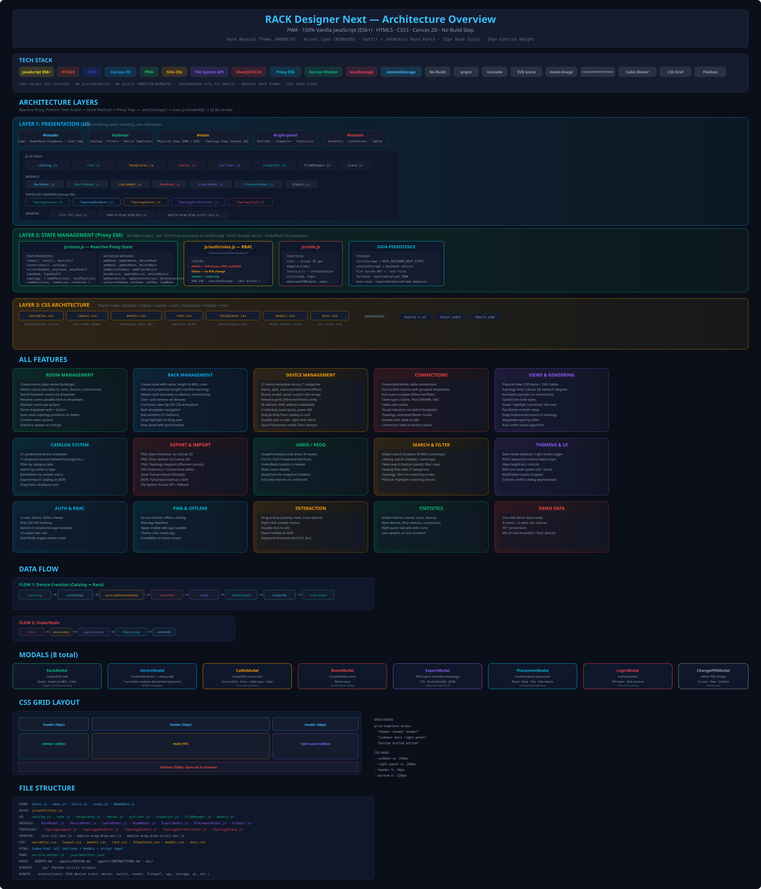

### 3.1 Canales Operativos del Sistema Actual

La interacción del usuario fluye a través de controladores de vista hacia el Store, el cual garantiza persistencia criptográfica e integridad relacional:


---

## 4. Motor Reactivo Central (Reactive Proxy Engine)

El núcleo reactivo en `js/store.js` intercepta cada lectura y escritura del estado global mediante la API nativa `Proxy`, implementando un ciclo unidireccional completo:

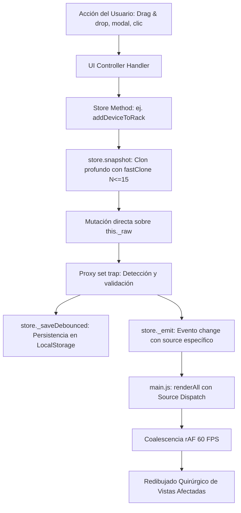

### 4.1 Ciclo de Vida Reactivo del Store

El diagrama a continuación detalla la detección en tiempo real de cambios en el estado y su propagación:

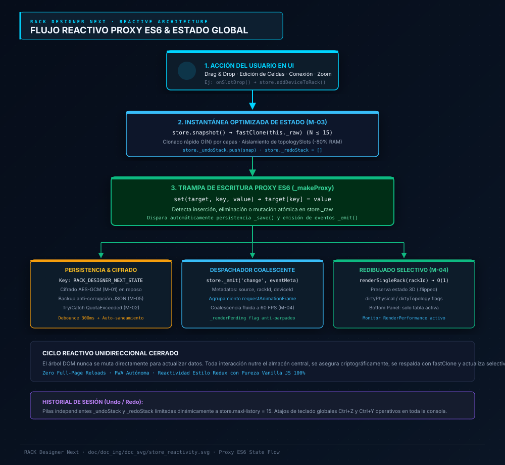

### 4.2 Flujo Integral de Datos

El ciclo completo de eventos desde la entrada periférica hasta el renderizado físico y topológico:

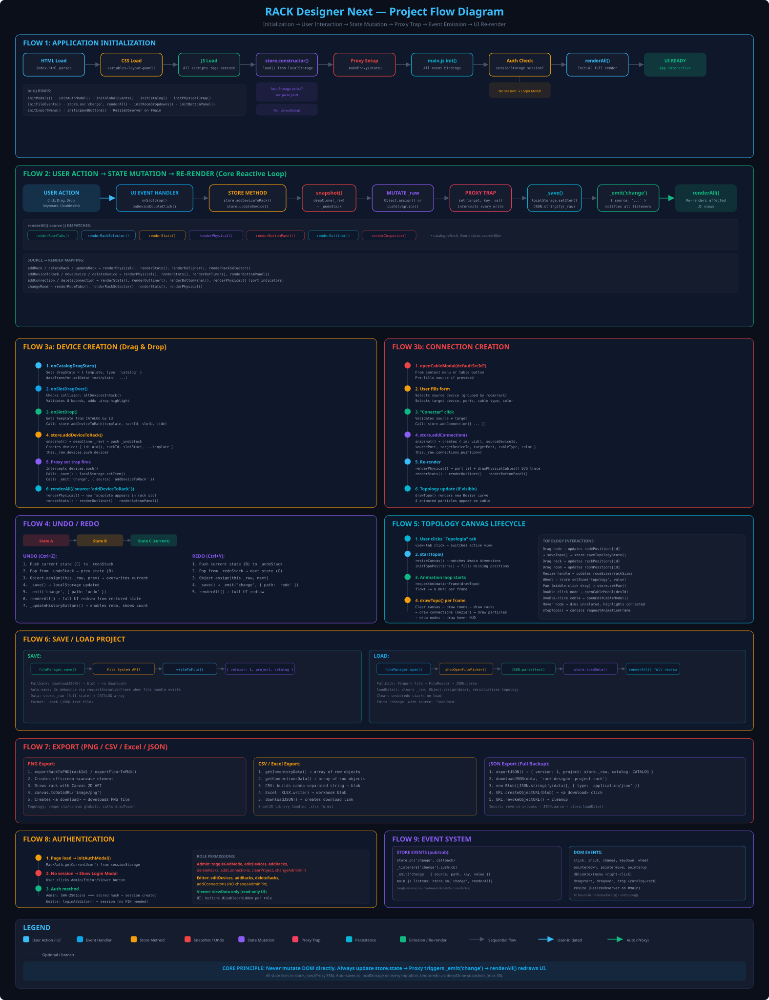

### 4.3 Implementación del Proxy con Caché Débil (`WeakMap`)

Para prevenir bucles de recursión infinita y evitar crear proxies redundantes sobre los mismos objetos, el Store mantiene una tabla `WeakMap`:

```javascript
_makeProxy(obj, path = '') {
  if (typeof obj !== 'object' || obj === null) return obj;
  if (this._proxyCache.has(obj)) return this._proxyCache.get(obj);

  const proxy = new Proxy(obj, {
    set: (target, key, value) => {
      // Protección contra contaminación de prototipos (Prototype Pollution)
      if (['__proto__', 'constructor', 'prototype'].includes(key)) return true;
      target[key] = value;
      this._saveDebounced();
      this._emit('change', { path: `${path}.${key}`, key, value });
      return true;
    },
    get: (target, key) => {
      const val = target[key];
      if (typeof val === 'function') return val.bind(target);
      if (typeof val === 'object' && val !== null && !Array.isArray(val)) {
        return this._makeProxy(val, `${path}.${key}`);
      }
      return val;
    }
  });

  this._proxyCache.set(obj, proxy);
  return proxy;
}
```

### 4.4 Despacho de Vistas por `source` (`renderAll Source Dispatch`)

`renderAll()` no reconstruye la pantalla completa de forma indiscriminada. Analiza la propiedad `source` del evento emitido para redibujar exclusivamente las vistas afectadas:

| Cadena `source` | Vistas que se reconstruyen | Optimización aplicada |
|---|---|---|
| `""`, `loadData`, `undo`, `redo` | Todas las vistas | Ciclo completo de hidratación |
| `Room`, `room-rename`, `changeRoom` | Selector de salas, selector de racks, métricas, lienzo físico | Mantiene el estado de herramientas abiertas |
| `Rack` | Selector de racks, árbol Outliner, lienzo físico, estadísticas | Redibuja únicamente el gabinete alterado |
| `Device`, `addDeviceToRack`, `moveDevice`, `deleteDevice` | Inspector, Outliner, carátulas de rack, tabla inferior | Reemplazo quirúrgico del elemento en el DOM |
| `Connection`, `addConnection`, `deleteConnection` | Capa SVG de cables, tabla de conexiones, inspector | Recálculo de curvas Bézier sin reconstruir el rack |
| `Zoom`, `Pan` | Ninguna reconstrucción del DOM | Transformación matricial `transform: translate() scale()` en GPU |

---

## 5. Modelo de Datos y Entidad-Relación (ERD Multi-Nivel)

La estructura de datos se divide en cuatro capas formales de abstracción que garantizan integridad referencial y normalización:

### 5.1 Nivel 1: Núcleo Atómico y Primitivas Base
Modela las estructuras primarias independientes del centro de datos físico: VLANs de red, definiciones de puertos de hardware, tipos de cables, cifrado simétrico y el motor de clonación:

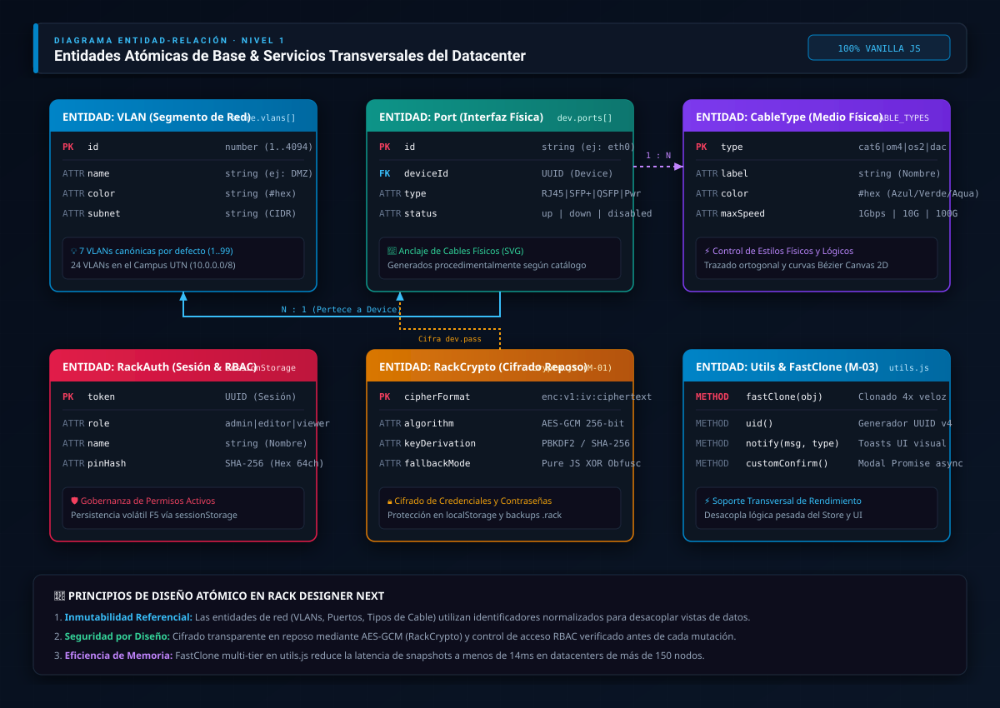

### 5.2 Nivel 2: Entidades del Datacenter Físico
Modela la jerarquía física fundamental: Salas (`Room`), Gabinetes (`Rack`), Dispositivos montados en rack y periféricos de piso (`Device`), y los enlaces de cableado estructurado (`Connection`):

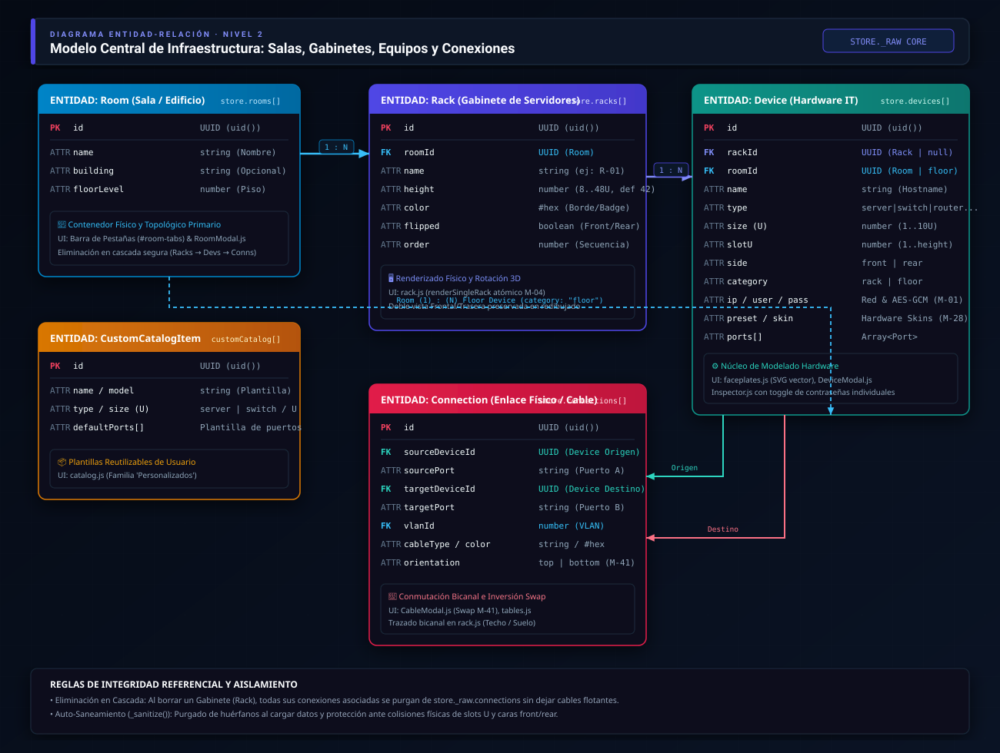

### 5.3 Nivel 3: Motor Topológico 2D
Define la geometría del canvas, cajas delimitadoras (bounding boxes), las 18 skins vectoriales modulares (`TopologySkins`), la matriz de transformación ortogonal y las 5 ranuras de memoria visual (`TopologySlots`):

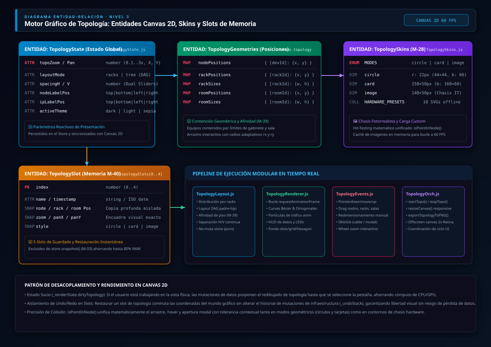

### 5.4 Nivel 4: Arquitectura Reactiva del Sistema Global
Mapea la orquestación global del ciclo de vida: `index.html`, `store.js` (Proxy ES6), `main.js` (rAF a 60 FPS), orquestadores modales, controladores de vista y la suite automatizada de 398 pruebas:


---

## 6. Arquitectura de Interfaz de Usuario y Layout CSS Grid

La interfaz gráfica de usuario está estructurada bajo el estándar **CSS Grid**, organizando el espacio de trabajo en 5 áreas fijas sin recálculos costosos de reflujo (reflow):

```css
#app {
  display: grid;
  grid-template-rows: var(--header-h) 1fr var(--bottom-h);
  grid-template-columns: var(--sidebar-w) 1fr var(--right-panel-w);
  grid-template-areas:
    "header  header        header"
    "sidebar main          right-panel"
    "bottom  bottom        bottom";
  height: 100vh;
  overflow: hidden;
}
```

### 6.1 Desglose de Áreas de la UI

#### Cabecera de Control y Navegación (Header)
Centraliza la gestión del proyecto (Nuevo, Abrir, Guardar, Demos), selector de salas activas, selector rápido de racks, alternancia de vistas (Física vs. Topología), conmutador de cableado SVG, historial Undo/Redo y badge de rol RBAC:

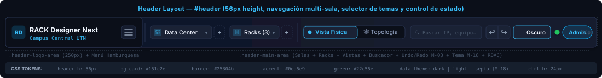

#### Catálogo Lateral Dinámico (Sidebar Flyout)
Panel colapsable de dos estados (50px modo iconos / 260px modo expandido). Alberga el catálogo estandarizado con **30 plantillas arquitectónicas** distribuidas en 8 familias comerciales:

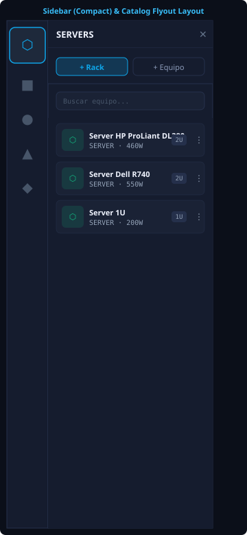

#### Lienzo Principal de Trabajo (Main Canvas)
Área de trabajo que alberga la vista física milimétrica con soporte para drag & drop y cables ortogonales, o bien el lienzo Canvas 2D de topología:

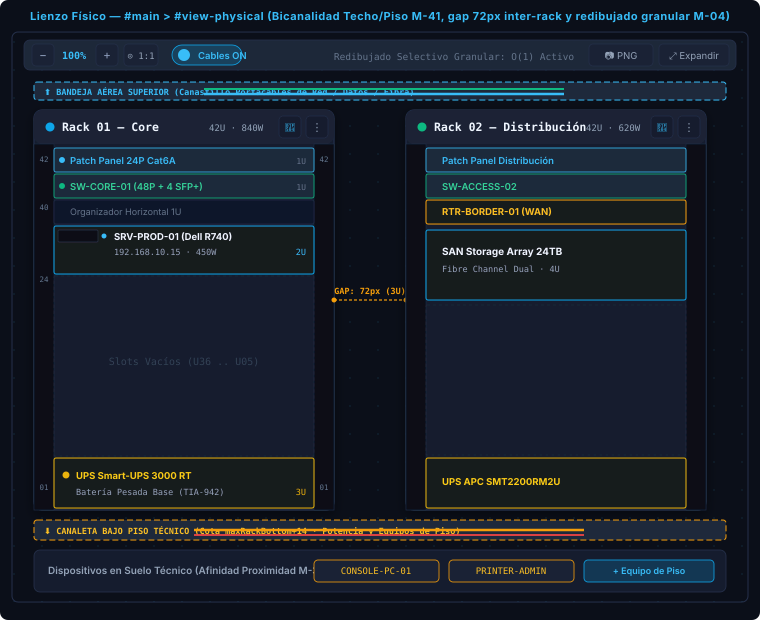

#### Panel Lateral de Propiedades (Right Panel)
Contiene el árbol de jerarquía (Outliner) con 4 modos de ordenación, el Inspector de propiedades con operaciones CRUD contextuales y el bloque de estadísticas en tiempo real:


#### Panel Inferior de Datos (Bottom Panel)
Tabla analítica de 18 columnas con selector dinámico de visibilidad, edición en línea, filtros y exportación formal a Excel (SheetJS), CSV y PNG Retina:


---

## 7. Renderizado Físico CAD y Bicanalidad Segregada

En la vista física (`#view-physical`), la escala del sistema es rigurosa: **1 Unidad de Rack (1U) equivale exactamente a 24 píxeles** (`--rack-unit-h: 24px`). Los racks poseen un ancho estándar de 240px (proporción dimensional 10:1) y una separación técnica de pasillo de **72px (3U)**.

### 7.1 Carátulas Vectoriales de Hardware (Faceplates SVG-First)
Cada uno de los equipos se dibuja mediante un archivo SVG vectorial de alta fidelidad ubicado en `assets/svg/default/`. Dichos archivos contienen animaciones CSS vectoriales `@keyframes` encapsuladas dentro del propio SVG (LEDs parpadeantes de enlace de red, actividad de almacenamiento y barras de carga).

### 7.2 Discriminación Frontal vs. Trasera con Giro 3D
Los racks admiten rotación visual en 3D mediante transformaciones CSS (`transform: rotateY(180deg)`). La base de datos del Store discrimina los puertos entre la cara frontal (`front`) y la cara posterior (`rear`), permitiendo a equipos de doble profundidad (`mountSide: 'both'`) alojar conexiones en ambas caras sin conflictos de colisión.

### 7.3 Arquitectura de Enrutamiento Segregado en 3 Zonas Libres

Para erradicar colisiones de cables sobre servidores o periféricos de piso, el motor de enrutamiento ortogonal en `js/ui/rack.js` confina las trayectorias vectoriales a tres zonas geométricas exclusivas:

#### 1. Canastillo Aéreo Superior (Inter-Rack)
Los cables entre distintos gabinetes se proyectan verticalmente hacia la zona superior libre (`overheadY = minRackTop - 14px - (index % 7) * 5`), viajando horizontalmente sin cruzar el chasis de los servidores intermedios:


#### 2. Canaleta Media Segregada (Equipos de Piso ↔ Gabinetes)
Los cables que enlazan periféricos de piso (UPS grandes, generadores, transformadores) ascienden a través de una canaleta intermedia segregada (`middleGutterY = maxRackBottom + 18px + (index % 6) * 4`) y suben por el pasillo lateral de 72px del rack anfitrión:

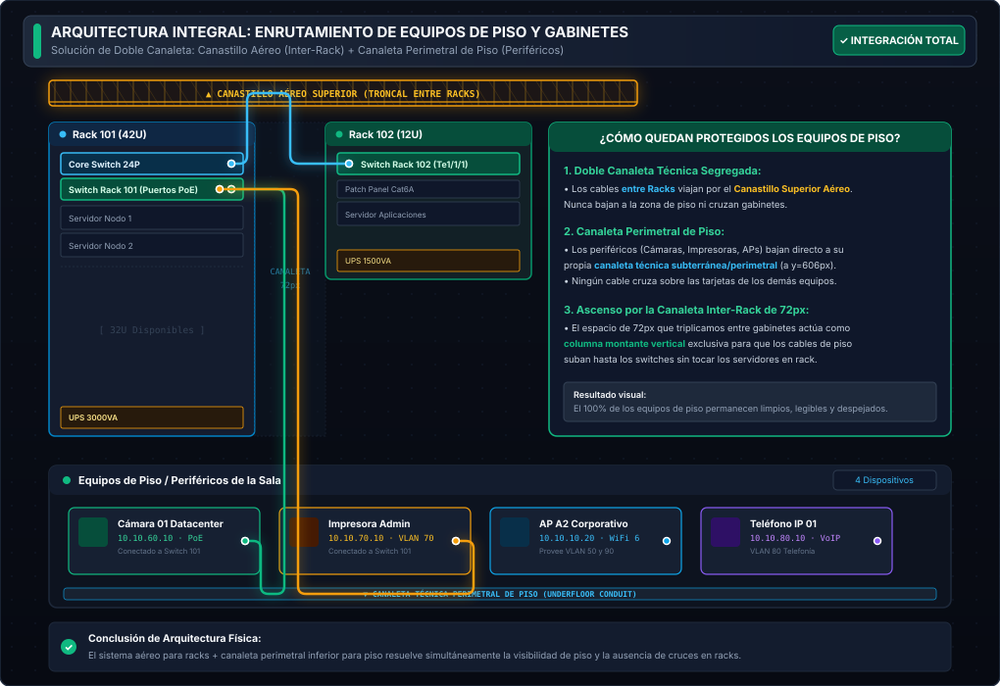

#### 3. Organizador Lateral de Gabinete (Intra-Rack)
Los enlaces entre equipos alojados dentro del mismo rack se confinan estrictamente a la canaleta vertical derecha del gabinete (`gutterX = p1.rightEdgeX + 8px + (index % 5) * 4`).

---

## 8. Motor Topológico de Red (Canvas 2D Engine)

La vista de topología lógica (`#topology-canvas`) es un motor de renderizado 2D implementado sobre la API Canvas de HTML5, diseñado bajo el patrón arquitectónico MVC y capaz de sostener 60 cuadros por segundo constantes:

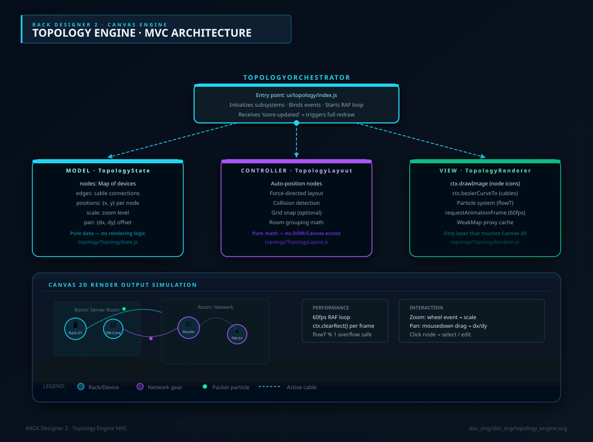

### 8.1 Componentes del Motor Topológico

| Componente | Archivo | Responsabilidad de Ingeniería |
|---|---|---|
| **Skins Modulares** | `TopologySkins.js` | 3 modos visuales (cards, circle, hardware skins), 18 presets offline e hit-testing unificado. |
| **Estado y Memoria** | `TopologyState.js` | Matriz de transformación (zoom, pan), hover, arrastre y 5 slots de memoria persistente. |
| **Distribución Espacial** | `TopologyLayout.js` | Algoritmos de distribución automática, árbol jerárquico DAG y afinidad espacial de piso. |
| **Renderizado 2D** | `TopologyRenderer.js` | Trazado por capas: grid de puntos, salas, racks, curvas Bézier con partículas y nodos. |
| **Manejador de Eventos** | `TopologyEvents.js` | Detección matemática de colisiones punto-polígono, arrastre, redimensionamiento y rueda del mouse. |
| **Orquestador Global** | `TopologyOrchestrator.js` | Bucle `requestAnimationFrame`, enlace con el Store y exportación a PNG en alta densidad. |

### 8.2 Topología Renderizada y Controles Visuales

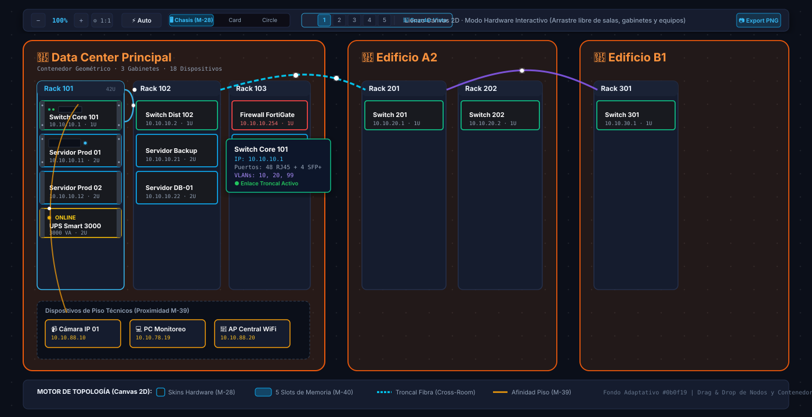

### 8.3 Algoritmo de Afinidad Espacial para Equipos de Piso
En el layout automático, los periféricos de piso no se dispersan aleatoriamente:
1. `_findAffinityRackForFloorDevice()` calcula la cantidad de enlaces físicos directos hacia cada rack.
2. El equipo se posiciona automáticamente alineado bajo el gabinete con el que mantiene mayor afinidad.
3. Se establece una línea de base uniforme a `floorBaseY = rackTopY + maxRackH + 28px`, garantizando armonía geométrica incluso con racks de alturas dispares (ej. 24U junto a 42U).

---

## 9. Adaptabilidad UX y Arquitectura PWA Modo Móvil

RACK Designer Next implementa una arquitectura responsiva completa adaptada para tablets de campo y smartphones en centros de datos.

### 9.1 Plano de Cotas y Medidas de Ingeniería (Breakpoints Móviles)

Especificación exacta de alturas táctiles mínimas (44px/48px), anchos de drawers off-canvas y márgenes seguros:


### 9.2 Arquitectura UX en Modo Móvil (≤768px)

En resoluciones móviles, el layout pasa de CSS Grid a una disposición contextual con drawers deslizables y panel inferior táctil:

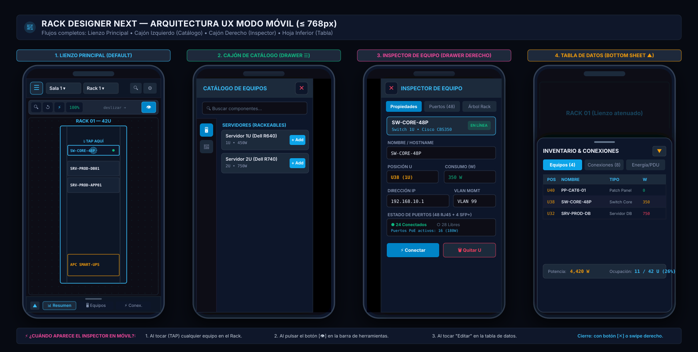

* **Drawers Off-Canvas:** El catálogo lateral y el panel de propiedades se ocultan fuera del viewport y se activan mediante gestos o botones dedicados con `z-index: 1000`.
* **Bottom Sheet Táctil:** El panel inferior se colapsa en un tirador táctil de 38px que puede expandirse hasta un 72% de la altura de la pantalla mediante arrastre táctil.
* **Modales 100% Opacos:** Todos los formularios de edición se ajustan a pantalla completa con scroll interno y botones de confirmación fijos al alcance del pulgar.

### 9.3 Topología en Pantallas Táctiles

Interacciones multitáctil adaptadas para gestos de pellizco (pinch-to-zoom), desplazamiento con dos dedos y auto-ordenamiento con un solo toque:

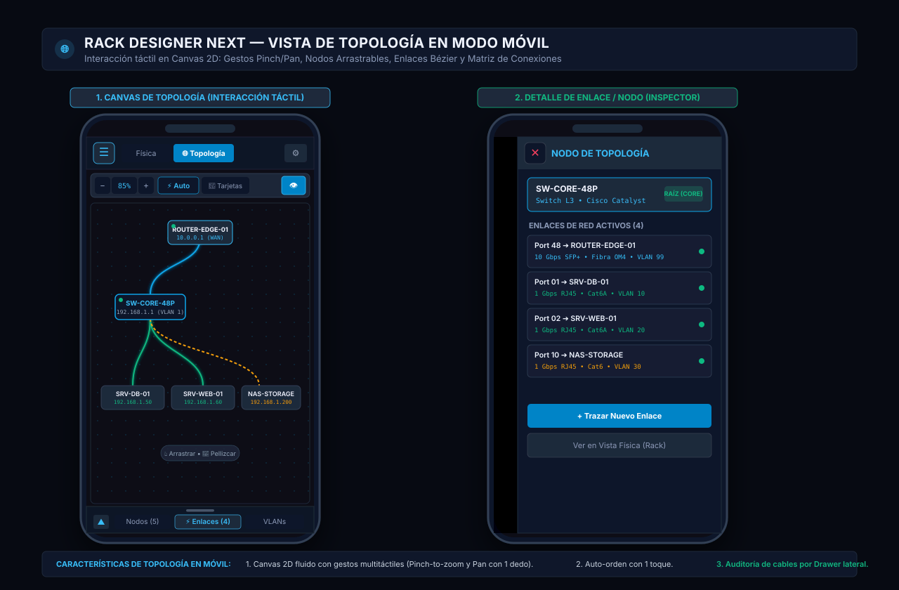

---

## 10. Seguridad Criptográfica y Control de Acceso (RBAC)

El subsistema de seguridad combina control de acceso basado en roles (RBAC) con protección criptográfica simétrica de nivel bancario en reposo y en tránsito.

### 10.1 Arquitectura Criptográfica y RBAC

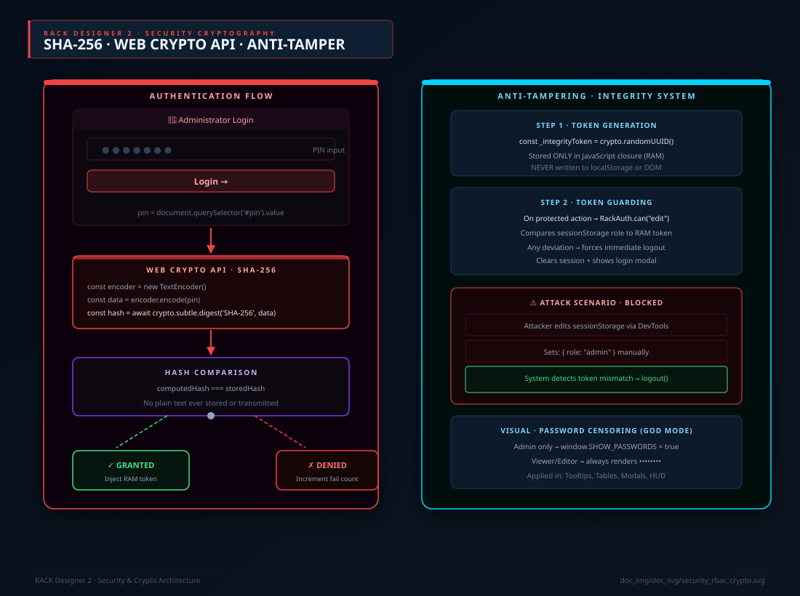

### 10.2 Matriz de Roles y Permisos


| Permiso | Administrador (`admin`) | Editor (`editor`) | Espectador (`viewer`) |
|---|:---:|:---:|:---:|
| `viewData` | ✅ | ✅ | ✅ |
| `editDevices` / `addRacks` / `deleteRacks` | ✅ | ✅ | ❌ |
| `addConnections` / `deleteConnections` | ✅ | ✅ | ❌ |
| `clearProject` / `importData` | ✅ | ✅ | ❌ |
| `toggleGodMode` (Revelar todas las contraseñas) | ✅ | ❌ | ❌ |
| `revealPassword` (Auditar contraseña individual) | ✅ | ❌ | ❌ |
| `changeAdminPin` | ✅ | ❌ | ❌ |

### 10.3 Blindaje Criptográfico en Reposo (`RackCrypto`)
* **Estándar:** Cifrado simétrico autenticado `AES-GCM` de 256 bits (`Web Crypto API`).
* **Formato del Ciphertext:** `enc:v1:<iv_base64>:<ciphertext_base64>`.
* **Vector de Inicialización (IV):** 12 bytes criptográficamente seguros generados de forma independiente por cada registro sensible (`crypto.getRandomValues`).
* **Protección Transparente:** El Store cifra contraseñas y claves de acceso antes de escribir en `localStorage` o exportar a `.rack`. Al cargar el proyecto, descifra en memoria volátil sin penalizar el rendimiento del renderizado.
* **Token de Integridad Anti-Tampering:** La sesión de administrador se valida contra un token volátil en `sessionStorage`. Si un usuario altera manualmente los valores del DOM o el almacenamiento, la sesión se destruye automáticamente.

---

## 11. Persistencia Híbrida, Formato .RACK y Exportación

El sistema combina el almacenamiento local en navegador con I/O directo sobre el sistema de archivos del sistema operativo mediante la **File System Access API**.

### 11.1 Arquitectura de Entrada/Salida (I/O) de Archivos

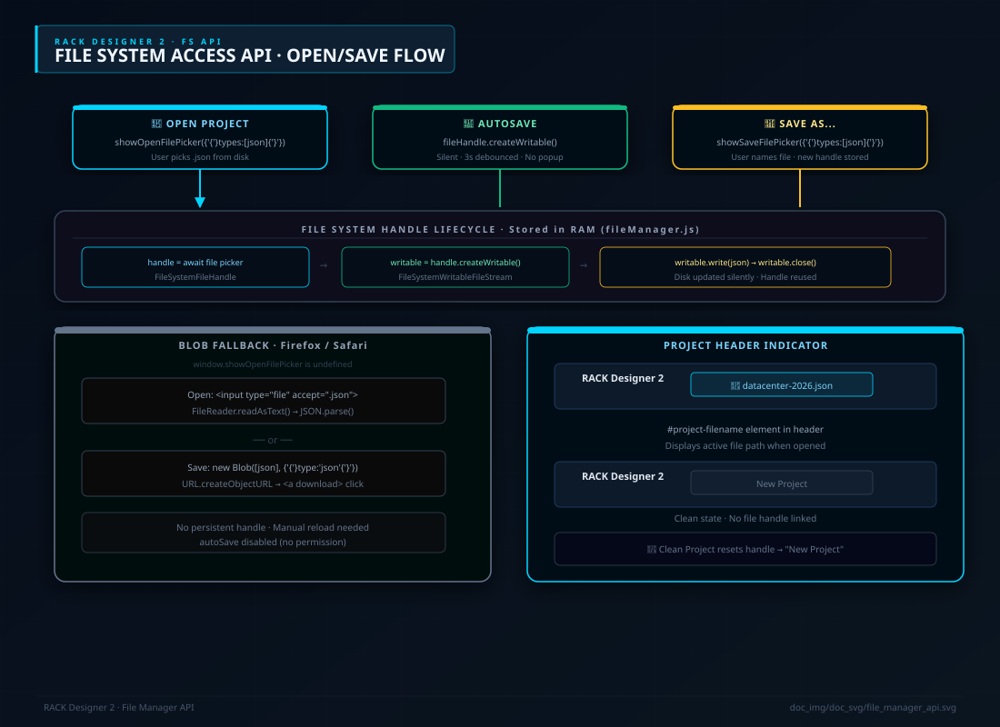

### 11.2 Sistema de Autoguardado e Historial
El sistema cuenta con un motor de autoguardado inteligente que escribe en disco tras 3 segundos de inactividad luego de la última mutación, respaldado por un slot redundante en `localStorage`:

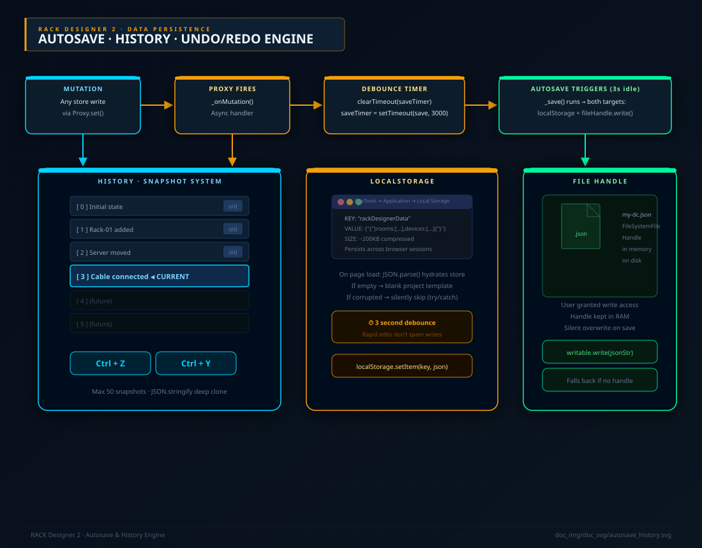

### 11.3 Subsistema de Exportación Masiva


* **Hojas de Cálculo Excel (.xlsx):** Generación binaria nativa mediante `xlsx.full.min.js` (SheetJS) con hojas de Inventario y Conexiones formateadas.
* **Reportes CSV:** Exportación estructurada compatible con hojas de cálculo y bases de datos relacionales.
* **Captura Retina PNG (1:1):** Renderizado DOM de alta resolución a 2x mediante `html2canvas.min.js` con fallback a Canvas 2D.

### 11.4 Service Worker y PWA Offline (Cache v52)
El archivo raíz `service-worker.js` gestiona una estrategia de caché determinista *Cache-First con actualización en segundo plano*. Proporciona disponibilidad total del software sin conexión a internet:

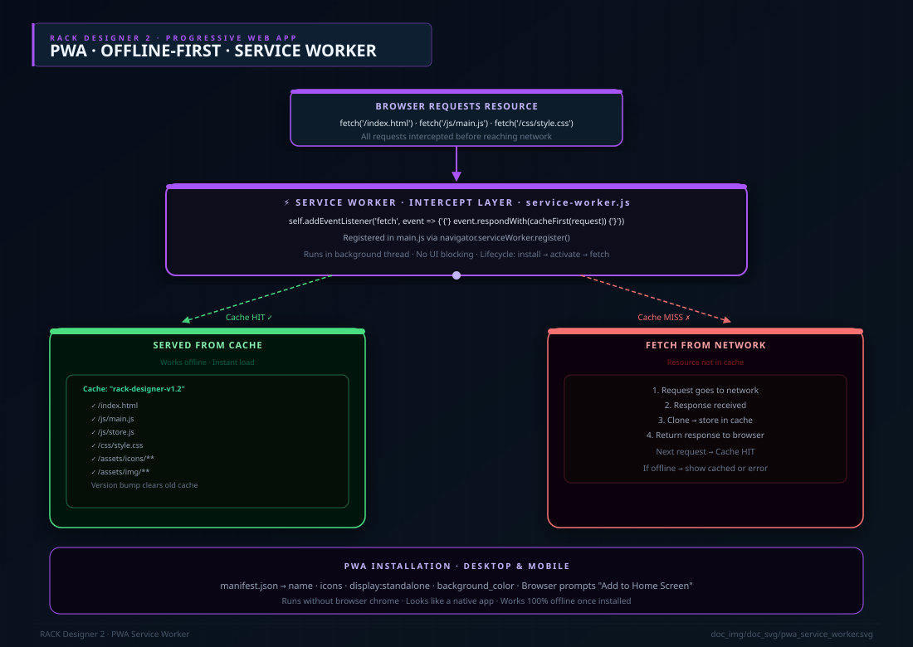

---

## 12. Grafo de Dependencias y Orden de Scripts Globales

El proyecto no utiliza bundlers ni módulos ES en el navegador; todas las librerías y scripts se ejecutan en el ámbito global mediante 32 etiquetas `<script>` ordenadas en `index.html`.

### 12.1 Mapa Maestro de Dependencias

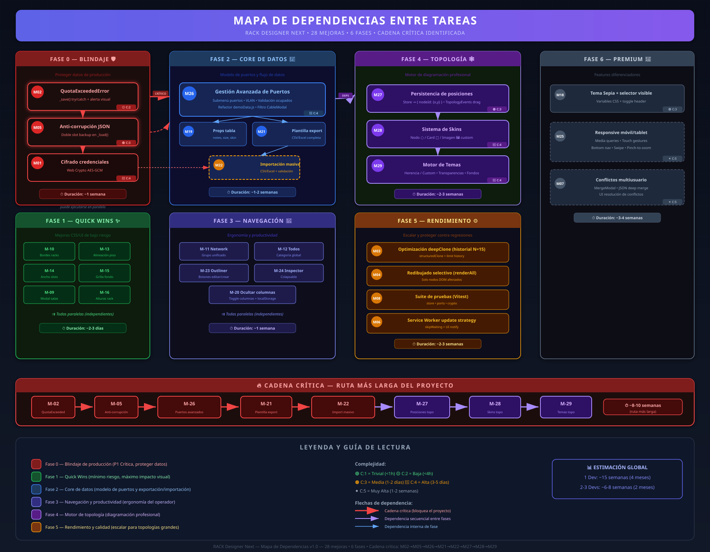

### 12.2 Estructura Jerárquica del Repositorio

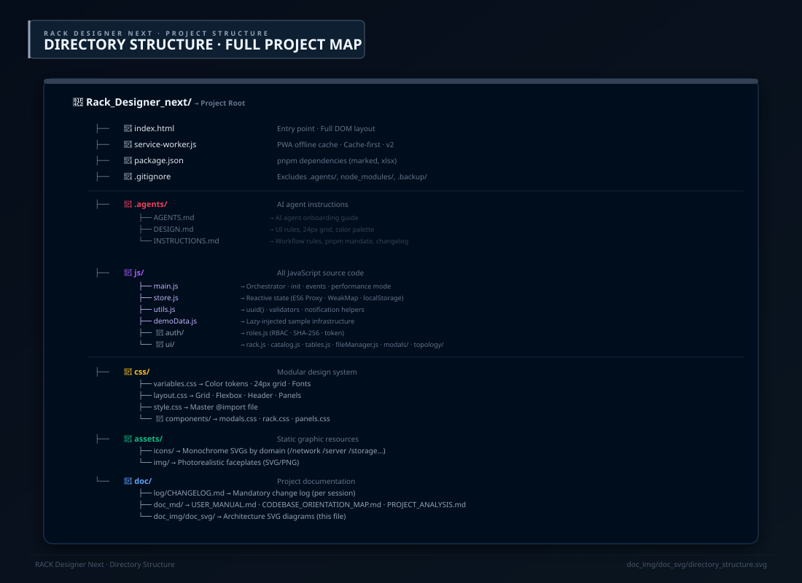

### 12.3 Secuencia Estricta de Carga de Scripts en `index.html`

```html
<!-- 1. Librerías Vendor de Terceros -->
<script src="js/xlsx.full.min.js"></script>
<script src="js/html2canvas.min.js"></script>
<script src="js/mobile-drag-drop.min.js"></script>
<script src="js/mobile-drag-drop-scroll.min.js"></script>

<!-- 2. Núcleo Reactivo, Utilidades e Iconografía -->
<script src="js/store.js"></script>
<script src="js/utils.js"></script>
<script src="js/icons.js"></script>
<script src="js/demoData.js"></script>

<!-- 3. Criptografía y Seguridad RBAC -->
<script src="js/auth/crypto.js"></script>
<script src="js/auth/roles.js"></script>

<!-- 4. Capa de Vistas UI (Controladores Base) -->
<script src="js/ui/catalog.js"></script>
<script src="js/ui/rack.js"></script>
<script src="js/ui/faceplates.js"></script>
<script src="js/ui/tables.js"></script>
<script src="js/ui/outliner.js"></script>
<script src="js/ui/inspector.js"></script>
<script src="js/ui/fileManager.js"></script>

<!-- 5. Componentes Modales Específicos -->
<script src="js/ui/modals/Globals.js"></script>
<script src="js/ui/modals/RackModal.js"></script>
<script src="js/ui/modals/DeviceModal.js"></script>
<script src="js/ui/modals/CableModal.js"></script>
<script src="js/ui/modals/RoomModal.js"></script>
<script src="js/ui/modals/ExportModal.js"></script>
<script src="js/ui/modals/ImportModal.js"></script>
<script src="js/ui/modals/PlacementModal.js"></script>
<script src="js/ui/modals.js"></script>

<!-- 6. Motor Topológico Canvas 2D -->
<script src="js/ui/topology/TopologySkins.js"></script>
<script src="js/ui/topology/TopologyState.js"></script>
<script src="js/ui/topology/TopologyLayout.js"></script>
<script src="js/ui/topology/TopologyRenderer.js"></script>
<script src="js/ui/topology/TopologyEvents.js"></script>
<script src="js/ui/topology/TopologyOrchestrator.js"></script>

<!-- 7. Inicializador Maestro (Debe cargarse al final) -->
<script src="js/main.js"></script>
```

---

## 13. Aseguramiento de Calidad y Suite de Integridad

El aseguramiento de calidad del proyecto se verifica mediante una suite automatizada dual: ejecución de consola en Node.js ([tests/integrity_check.cjs](file:///c:/Users/admin/.gemini/antigravity/scratch/Rack_Designer_2/tests/integrity_check.cjs)) y visualizador en navegador ([tests/index.html](file:///c:/Users/admin/.gemini/antigravity/scratch/Rack_Designer_2/tests/index.html)).

```
=========================================================================
  SUITE DE INTEGRIDAD AUTOMATIZADA — RACK DESIGNER NEXT
=========================================================================
  Total de Pruebas Ejecutadas: 398
  Pruebas Exitosas:           398 (100.0%)
  Pruebas Fallidas:             0 (0.0%)
  Grupos de Prueba Evaluados:  25
=========================================================================
```

### 13.1 Cobertura por Grupos de Prueba

1. **Proxy Reactivity & WeakMap Traps:** Verificación de trampas get/set, prevención de bucles y protección contra prototipos.
2. **Cifrado Simétrico AES-GCM:** Generación de IVs únicos, cifrado en reposo, descifrado en memoria y serialización `.rack`.
3. **Autenticación SHA-256 & Sesión Volátil:** Hashing, persistencia de tokens de seguridad y verificación RBAC.
4. **Integridad Relacional en Cascada:** Borrado en cascada de gabinetes/equipos y purga de conexiones zombis.
5. **Cálculo Físico CAD 1U=24px:** Detección de colisiones de slots U, límites de altura y segregación por cara física (`mountSide`).
6. **Enrutamiento Ortogonal de Cables:** Canastillo superior aéreo, canaleta media de piso y organizador vertical interno.
7. **Motor de Topología 2D:** Skins modulares (card/circle/image), árbol DAG, algoritmo de afinidad espacial y 5 ranuras de memoria.
8. **Interacciones Móviles & PWA:** Drawers laterales, Bottom Sheet colapsable y caché offline v52.
9. **Importación y Exportación Masiva:** Validación de esquemas Excel/CSV, detección reactiva de colisiones y generación PNG Retina.

---

## 14. Matriz Histórica de Mejoras y Evolución

El proyecto ha completado de forma satisfactoria su ciclo de modernización integral (Mejoras M-01 a M-41), consolidando todas las capacidades técnicas y archivando formalmente el backlog en [doc/doc_md/historico/mejoras_archivadas.md](file:///c:/Users/admin/.gemini/antigravity/scratch/Rack_Designer_2/doc/doc_md/historico/mejoras_archivadas.md).

### 14.1 Resumen de Fases Consolidadas

* **Fase 1 (Seguridad y Reactividad):** Cifrado AES-GCM en reposo (M-01), saneamiento automático de conexiones zombis (M-02) y optimización transaccional de Undo/Redo acotado (M-03).
* **Fase 2 (Rendimiento y Cableado Avanzado):** Redibujado atómico por gabinete (M-04), soporte de doble cara frontal/trasera (M-33) y enrutamiento interactivo Drag-to-Connect con rubber-band en tiempo real (M-34).
* **Fase 3 (Topología de Nueva Generación):** Skins fotorrealistas de hardware (M-28), distribución en árbol jerárquico DAG (M-32), afinidad espacial para periféricos de piso (M-39) y 5 slots de memoria visual (M-40).
* **Fase 4 (PWA Móvil y Tablas Dinámicas):** Adaptabilidad completa para dispositivos móviles (M-25A/M-25B), selector dinámico de columnas (M-11) e importación/exportación masiva con detección reactiva de conflictos (M-21/M-22).
* **Fase 5 (Bicanalidad Segregada y Calidad Total):** Bicanalidad física segregada (M-41), doble dataset demo (TIA-942 y Campus UTN) y consolidación de la suite de 398 pruebas automatizadas al 100%.

---

> **RACK Designer Next — Ingeniería de Datacenters de Vanguardia**  
> *Documento técnico oficial mantenido y sincronizado con el código fuente del proyecto.*
